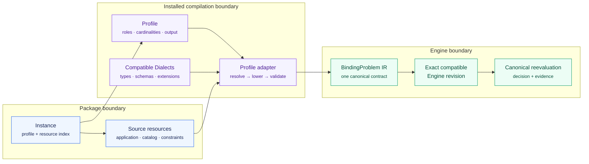

# OpenBinding

OpenBinding is to QoS-aware service binding and composition problems what
[SPHERE](https://sphere.score.us.es) is to SaaS pricings: a **repository** of
versioned, citable binding problems, a **collaborative analysis** platform and a
**laboratory** that compares interchangeable engines reproducibly. Problems are
written in **BIM v1**, the Binding Instance Model, an extensible language whose
profiles and dialects compile every problem to one canonical IR; the gateway
re-evaluates every engine answer so results are comparable and verifiable by
digest. Target architecture: [`docs/ARCHITECTURE.md`](docs/ARCHITECTURE.md).

Its layers stay deliberately separate:

- BIM packages compile through installed Profiles and Dialects into a canonical
  IR before any engine sees them.
- PostgreSQL owns users, collaboration, jobs, provenance and release metadata;
  Redis delivers durable work and one-use CAS state.
- OpenBinding's own pricing lives in SPHERE and is operated by SPACE, which
  follows SPHERE's permanent link. OpenBinding talks to SPACE only through its
  official clients (`space-python-client`, `space-react-client`), reads SPHERE
  only through its public API and renders pricings with `pricing-renderer`.
  It has no pricing editor or contract console of its own.
- Nothing is metered or charged: there are no credits or compute units, and the
  only execution limit that is not a plan entitlement is a technical
  per-account concurrency cap (`MAX_CONCURRENT_JOBS_PER_USER`, answered with
  `429 concurrency_limit_exceeded`). The former automatic Engine selection was
  retired and has no replacement.
- Universidad de Sevilla CAS accounts receive the `RESEARCH` contract and a
  compact institutional mark. No identity is ever linked by email alone.

For the target layers of the gateway and the BIM/platform boundary, see
[`docs/ARCHITECTURE.md`](docs/ARCHITECTURE.md); for the guarantees of job
submission and execution, [`docs/IDEMPOTENCY.md`](docs/IDEMPOTENCY.md).

See the [interactive BIM v1 architecture map](docs/diagrams/bim-v1-architecture.html) for the package, compilation, and engine boundaries.

## Contributing

See [`CONTRIBUTING.md`](CONTRIBUTING.md), [`TESTING.md`](TESTING.md) and [`SECURITY.md`](SECURITY.md).

## BIM v1 at a glance



BIM follows the architectural idea that makes
[WS-Agreement](https://ogf.org/documents/GFD.107.pdf) useful across domains: a
small common container defines composition and extension contracts, while
versioned sublanguages supply the concrete service descriptions, conditions,
metrics, workflows, and objectives. BIM adopts that modularity, not
WS-Agreement's XML syntax, agreement protocol, negotiation lifecycle, or
runtime model.

An instance is rooted at `instance.json` and selects an installed Profile with
one compact field, for example `spec.profile: qos-binding/v1`. The Profile—not
the BIM core—declares the available roles, resource-type cardinalities, output
IR, capability vocabulary, limits vocabulary, and lowering adapter. Installed
Dialects contribute complete resource types or schema-pinned inline extension
points to those roles. This keeps independently authored application,
candidate, constraint, optimization, workflow, and placement modules
composable without enlarging the core language.

The only executable Profile shipped in v1 is `qos-binding/v1`. It defines the
roles `application`, `candidateCatalog`, `constraintSet`, and `optimization`.
Its JSON resources use `apiVersion: qos-binding/v1`; Placement is the separate
`qos-binding-placement/v1` sublanguage, and BPMN 2.0.2 is recognized by its XML
QName through an installed Dialect. QoS values are finite deterministic
scalars. Scheduling, probabilistic QoS, risk, telemetry, and runtime adaptation
are outside this Profile.

Git stores packages as readable directories. Transport uses deterministic
`.bim.zip` archives with `instance.json` as the root index. Compilation resolves
only installed, digest-pinned Profiles, Dialects, schemas, and adapters, then
emits the single IR declared by the Profile. Engines receive that IR—not source
files—and are selected by generic IR feature/capability compatibility.

## Running locally

```bash
./up.sh
```

For the complete collaborative stack, copy `.env.example`, set a signing
secret, and start the development profile. SPACE (`https://space.score.us.es`)
and SPHERE are remote services configured through `SPACE_URL`/`SPACE_API_KEY`
(`MANAGEMENT` scope) and `SPHERE_*` in `.env` (`SPACE_ENABLED` and
`SPHERE_ENABLED` are `false` in `.env.example`); no copy of them is deployed
locally and they are administered in their native UIs:

```bash
docker compose --profile dev up -d --build     # development
```

Production uses the digest-pinned, standalone
definition in `deploy/compose/production/` and is operated with
[`docs/runbooks/production.md`](docs/runbooks/production.md); only the owner
orders a production deployment. The project deploys with Docker Compose only.
The gateway, the worker and the seed run BIM in process; the standalone
`bim-service` container is a separate deployable of the BIM toolchain, described in its
[`SERVICE.md`](https://github.com/javiercavlop/bim-toolchain/blob/v0.2.0/docs/SERVICE.md).

Building the gateway image, or running `uv sync` in
`openbinding-gateway`, downloads the BIM toolchain wheels from a private GitHub
repository, so it needs a token that can read it; see
[BIM toolchain](#bim-toolchain).

`docker-compose.yml` defines the profiles `dev`, `db-tools` (Adminer) and
`federated-example`. `dev` starts PostgreSQL, Redis,
the gateway, the job worker, the four bundled Engines, the frontend and
nginx. With `APP_ENV=prod` (production only) the gateway refuses to start unless
`CORS_ALLOW_ORIGINS` names exact origins. Whether the stack, SPACE and SPHERE
work together end to end against the real remote services has not been
exercised yet.

**Development scope.** The development pricing and the development service
registered in SPACE are private and distinct from the production ones, but
they live inside the *same organizations*. A shared organization does **not**
isolate credentials: a development `SPACE_API_KEY` or `SPHERE_API_KEY` with
`MANAGEMENT` scope can act on whatever that organization holds, so treat it as
a high-risk secret, keep it out of images, logs and the browser, and never reuse
a production key for development.

The web application is available at `http://localhost`; the gateway publishes
its OpenAPI document at `http://localhost:8000/docs`. Adminer is an explicitly
local emergency tool and binds only to loopback:

```bash
docker compose --profile db-tools up -d adminer
```

### Quick start: upload, run, study

The organization is the only container: it holds problems, runs and studies. In the web application, open an
organization, then **Problems → Upload BIM package** (or start one in the Workbench from a template), **Run this
version** on the problem page, and **Studies → New study** to compare engines over versions and seeds. The same walk
through the API, signed in with a token (`TOKEN`) of a MEMBER of the organization `my-lab`:

```bash
API=http://localhost:8000
AUTH="Authorization: Bearer $TOKEN"
# 1. Upload a package as a new problem (revision 1); the gateway compiles it once.
curl -sS "$API/v1/bim/templates/demo/01_simple_seq" -o simple-seq.bim.zip
curl -sS -H "$AUTH" -H 'Content-Type: application/vnd.bim+zip' --data-binary @simple-seq.bim.zip \
  "$API/v1/organizations/my-lab/problems?slug=simple-seq"
# 2. Run that revision on an engine mode (202, then poll the run until it is completed).
curl -sS -H "$AUTH" -H 'Content-Type: application/json' "$API/v1/organizations/my-lab/runs" \
  -d '{"revision": "<revision id>", "engine": "random-search", "mode": "seeded",
       "optimization": {"type": "SINGLE", "scalarization": "weighted-sum"}}'
curl -sS -H "$AUTH" "$API/v1/organizations/my-lab/runs/<run id>"
# 3. A study of the revision x engine modes x seeds, and a run of it, which freezes the definition.
curl -sS -H "$AUTH" -H 'Content-Type: application/json' "$API/v1/organizations/my-lab/studies" \
  -d '{"slug": "seeds", "name": "Seeds", "definition": {"revision_ids": ["<revision id>"],
       "engines": [{"namespace": "bim.builtin", "name": "random-search", "version": "1.0.0", "digest": "<digest from /v1/engines>",
                    "mode": "seeded", "optimization": {"type": "SINGLE", "scalarization": "weighted-sum"}}],
       "parameter_sets": [{}], "seeds": [1, 2]}}'
curl -sS -H "$AUTH" -X POST "$API/v1/organizations/my-lab/studies/seeds/runs"
```

`POST /v1/bim/validate` checks a package without storing it. The walk is also an API test
(`openbinding-gateway/tests/test_f0b_walk.py`), a mocked browser test (`frontend/e2e/f0b-walk.spec.ts`), a live
browser test against the lab (`frontend/e2e/live/03-upload-run-study.spec.ts`) and steps 3 to 5 of
`openbinding-gateway/tools/smoke_lab.py`.

### Compositions: from a run to a versioned final composition

A **composition** is one binding of a problem's workflow to services, with the global values it yields, written in
[Composition2Yaml](docs/COMPOSITION2YAML.md) (a quoted `syntaxVersion: "1.0"`, the workflow, one binding entry per
task, the values and, optionally, the problem it was judged against and the composition's own offering). It stands
to the problem as a subscription stands to a Pricing2Yaml pricing. `POST /v1/organizations/{org}/compositions/{c}/derive`
with `{"run": "<run id>", "version": "1.0.0"}` turns a run's solution into a version (or `{"revision":
"simple-seq@1", "binding": {...}}` a binding of a revision); the same binding always gives the same bytes. A hand-written
document is checked with `…/versions/check` and sealed with `POST …/versions`. Linked to a problem, its values are the
toolchain's, re-computed on every seal (`verified`); without one, they are stored as written (`declared`). Versions are
compared (`…/diff`), re-evaluated by a new toolchain release (`…/versions/{v}/evaluations`), explored with other
bindings (`…/evaluate`, `…/neighborhood`) and forked into another organization (`…/fork`). Run presets
(`/v1/organizations/{org}/presets`) name the settings a run starts from (`createRun {revision, preset}`). The whole path
is an API test (`openbinding-gateway/tests/test_f1_walk.py`); the decisions are ADRs 0041 to 0046.

On the web, an organization's compositions are its Compositions tab (`/orgs/<org>/compositions`) and a page per
composition (`/compositions/<org>/<composition>`) with Overview (values and their status, the workflow, the providers
and upstream plan references, the problem's candidates), Analytics (how structure and values evolved), Configuration
(every one-task alternative and a configurator, on the linked problem), Versions (the version graph, and two versions
compared entry by entry and line by line) and Settings. Compositions are written in the editor (`/editor`, with the
gateway's live lint and check, and a visual pane). A run's result offers "Keep as composition". An ADMIN can make a
composition public: anybody then reads it at its page, finds it in the public list at `/compositions`, opens it from
its permanent link (`/p/<id>`), and, signed in, forks it into an organization of their own. `/language` is the
Composition2Yaml reference. Every number shown comes from the gateway; the decisions are ADRs 0047 to 0050, and the
walks are `frontend/e2e/f2a-*.spec.ts` (mocked) and `frontend/e2e/live/08-derive-seal-compare.spec.ts` and
`09-public-fork.spec.ts` (against the lab).

Problems are written in the problem editor (`/problem-editor`): it opens a template, a problem version or a
blank package, checks it with the gateway as it is edited, places each finding on the matrix cell, the file or the
diagram element it is about, and saves the package as a problem version. Its candidate matrix, workflow graph and rules
are the ones the problem page and the composition screens draw from the gateway's facts; a value edited in the matrix is
written where the package declares it. The problem page adds Candidates and Compositions tabs, studies show the
gateway's Pareto front of each problem version (one composition derived per point) and export their runs from the
server, and runs and studies start from run presets. The decisions are ADRs 0051 and 0052, and the walks are
`frontend/e2e/f2b-*.spec.ts` (mocked) and `frontend/e2e/live/10-problem-editor.spec.ts` and `11-study-front.spec.ts`
(against the lab).

### Reset the dev database

The schema is one Alembic revision, regenerated from the models
(`openbinding-gateway/tools/rebaseline.py`) under a new revision id whenever it
changes. Nothing is migrated: a database built from an older baseline is
refused, and `gateway-dev` exits during Alembic with `Rebuild the local
development database`. Recreate only the local PostgreSQL volume and start the
stack again:

```bash
docker compose stop postgres
docker compose rm -f postgres
docker volume rm openbinding_pgdata
./up.sh
```

The volume name follows the Compose project name; use
`docker volume ls --format '{{.Name}}'` if `COMPOSE_PROJECT_NAME` is set. This
procedure leaves Redis, the stored packages and other development volumes intact.

### Seeding development data

To populate the database with a complete set of development entities (users, hierarchical organizations, problems with compiled revisions, real solver runs, comparative studies, compositions (`simple-seq` derived from a run, with a second version and public; `tomatometer-sketch` declared) and API keys) for testing all platform features:

```bash
# Seed development data (idempotent: adds or updates without duplicating)
./tools/seed_dev.sh

# Or clean previously seeded entities and repopulate from scratch
./tools/seed_dev.sh --reset

# Directly through Docker Compose
docker compose exec -T gateway-dev python tools/seed_dev.py --reset
```

All test accounts (`alice`, `bob`, `carol`, `david`, `elena`, `frank`) use password: `devpass123`.
The administrator (`admin`) uses `devpass123`.

The gateway ships no default administrator. To start with one, set
`BOOTSTRAP_ADMIN_USERNAME` and `BOOTSTRAP_ADMIN_PASSWORD` in `.env`, or opt in
with `SEED_DEFAULT_ADMIN=true` plus `BOOTSTRAP_ADMIN_PASSWORD` to get an `admin`
account in an empty database. The `dev` profile publishes the gateway on
`127.0.0.1:8000` only, so it is not reachable from other machines.


The gateway exposes the stateless BIM services (`/v1/bim/validate`,
`/v1/bim/templates`), the problems of each organization
(`/v1/organizations/{org}/problems`, with their sealed revisions and
compilations), `/v1/engines` (and `/v1/engines/protocol` for federated engines),
`/v1/engine-registrations` and the runs of each organization
(`/v1/organizations/{org}/runs`). BIM source uploads are complete
`.bim.zip` packages; a run names a problem revision of its organization. A new run
always returns `202`. Results use `OPTIMAL`, `FEASIBLE`, `INFEASIBLE`, or `UNKNOWN`;
the BIM services answer errors as `application/problem+json` with source-located
diagnostics, and the organization's routes as the platform JSON envelope.

The frontend is built as SPHERE's (its stack, its layouts and its pages; ADR 0053).
The problem editor (`/problem-editor`) works over the same package and compiler
contracts used by API clients; it saves a valid package as a new problem or a new
version, and runs nothing itself. Around it: the organizations and their
problems, runs and studies, the public engine catalogue (`/engines`) and the
account's engines (`/me/engines`) with owner telemetry. Pricing is managed in the
remote SPHERE and SPACE UIs, not in OpenBinding.

### Scientific Provenance, Deep Inspection & Replication

OpenBinding guarantees strict cryptographic immutability and provenance:
- **In-browser ZIP Uncompression & Inspection**: Explore `.bim.zip` problem revisions directly in the browser with directory trees and syntax-highlighted code inspection in the bundled Monaco editor.
- **Frozen study definitions**: A study keeps its editable matrix inline; every study run freezes a copy of it, with its digest and the compilation each problem revision runs on, so editing a study never changes what a run ran. Archive/restore preserves execution history.
- **Dedicated Deep-Linked Views**: Full-page inspection and editing for Problems (`/problems/:org/:problem`), their revisions, Runs (`/runs/:org/:run`) and Studies (`/studies/:org/:study`).

## Repository layout

- `schemas/bim/v1`: BIM core, Profile, Dialect, IR, and bundled sublanguage
  contracts.
- `openbinding-gateway`: secure package handling, BIM compilation, registry,
  provenance, and the OpenBinding `/v1` API.
- `frontend`: the BIM Instance Workspace.
- `space`: only the pricing fixture (`space/pricing/openbinding.yml`); SPACE
  itself is remote.
- `pricings`: third-party FaaS pricing documents (AWS, Azure, Google Cloud)
  that BIM experiments analyse. They are **not** OpenBinding plans; see
  [`pricings/README.md`](pricings/README.md).
- `engines`: MiniZinc, random-search, many-heuristic, evolutionary modes,
  and the federated `multi-heuristic` example.
- `examples` and `experimentation`: BIM v1 packages and reproducible experiments.

The QACO problem generator (QACOForge) and the QACOBench benchmark live in their
own repository, [`javiercavlop/QACOForge`](https://github.com/javiercavlop/QACOForge)
(private for now). Its packages enter OpenBinding as native BIM problems.
QACOBench 1.1.1 reproduces from the tag `pre-redesign` of this repository.

### BIM toolchain

The BIM language (`bim-core`: compilation and evaluation; `bim-client`: the
`BimPort` with in-process and HTTP implementations; `bim-service`: an HTTP API
under `/bim/v1`) lives in its own repository,
[`javiercavlop/bim-toolchain`](https://github.com/javiercavlop/bim-toolchain),
**private** for now (the owner plans to move it to the SCORELabUS organization
when it goes public). OpenBinding consumes its release **v0.2.0**:
`openbinding-gateway/pyproject.toml` pins `bim-core==0.2.0` and
`bim-client==0.2.0` (and `bim-service==0.2.0` only in the `test` extra) as wheels
of the GitHub Release: `uv.lock` names them as files of `openbinding-gateway/.bim-wheels/`
with the SHA-256 of the release assets. The
`bim-core` wheel carries the five OMG BPMN 2.0.2 XSDs (the owner's decision of
2026-11-14; their redistribution rights are still not demonstrated, see the
toolchain's
[`OMG_XSD_RIGHTS.md`](https://github.com/javiercavlop/bim-toolchain/blob/v0.2.0/docs/OMG_XSD_RIGHTS.md)).

GitHub serves the assets of a private repository only through its API with a token, so
`python3 tools/fetch_bim_toolchain.py --wheels` downloads them into `.bim-wheels/` and
keeps a file only if its SHA-256 is the lock's; run it before `uv sync`. The token is
`BIM_TOOLCHAIN_TOKEN` (a fine-grained token with read-only Contents access to
`javiercavlop/bim-toolchain`), or else that of `gh auth token`:

- Docker builds run the same tool with the build secret `bim_toolchain_token`, taken
  from the environment variable `BIM_TOOLCHAIN_TOKEN` (declared in `docker-compose.yml`,
  and `compose.lab*.json`), so export it
  before building;
- CI uses the repository secret `BIM_TOOLCHAIN_TOKEN` through
  `.github/actions/bim-toolchain-access`.

Upgrading the toolchain is a pull request here that bumps the pin (new wheel files and
hashes in `uv.lock`) and passes
the consumer contract of the CI job `bim-toolchain`. See [BIM core](docs/BIM_CORE.md).

Start with the [progressive BIM model atlas](docs/models/README.md) for the
metamodels and concrete instances, continue with the
[BIM architecture](docs/BIM_V1.md), follow the
[authoring guide](docs/AUTHORING_GUIDE.md), or read the
[engine integration guide](docs/ENGINE_INTEGRATION.md).

For a complete external deployment example, see the
[`multi-heuristic` federation walkthrough](examples/federation/multi-heuristic/README.md).

The full platform, BIM, `qos-binding/v1`, extension and operations guides live
in the companion
[OpenBinding documentation repository](https://github.com/javiercavlop/OpenBinding-docs).

## Regression suites

The pull-request workflow compiles the complete checked-in BIM corpus, tests
every engine, runs the frontend unit and browser suites, and executes the real
gateway integration suite. With the Compose development stack running, the two
cross-version scientific regressions can also be repeated directly:

```bash
# The complete BPMN package and its native-JSON twin must compile to the same
# semantic IR and return identical solutions in every bundled/federated engine.
docker compose exec -T gateway-dev test \
  tests/integration/test_engine_representation_regression.py -m integration

# Regenerate mediaOrch/146588263/infrastructure_50, reproduce the historical
# MiniZinc optimum, and classify the seeded heuristic results. Needs the ICSOC
# source dataset from the data/icsoc-original-dataset branch (see
# experimentation/icsoc/README.md); the test is skipped without it.
docker compose exec -T gateway-dev test \
  tests/integration/test_icsoc_regression.py -m integration

# Ownership, private/public visibility, moderation and the admin-owned example.
docker compose exec -T gateway-dev test \
  tests/test_v1_lifecycle_rbac.py tests/test_federated_multi_heuristic_example.py
```
