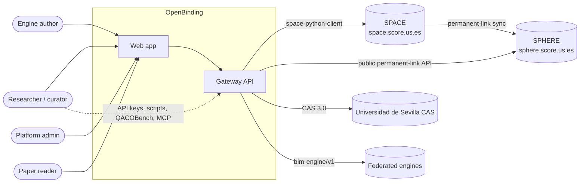
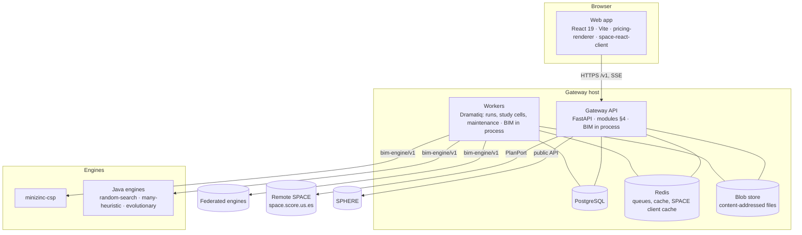
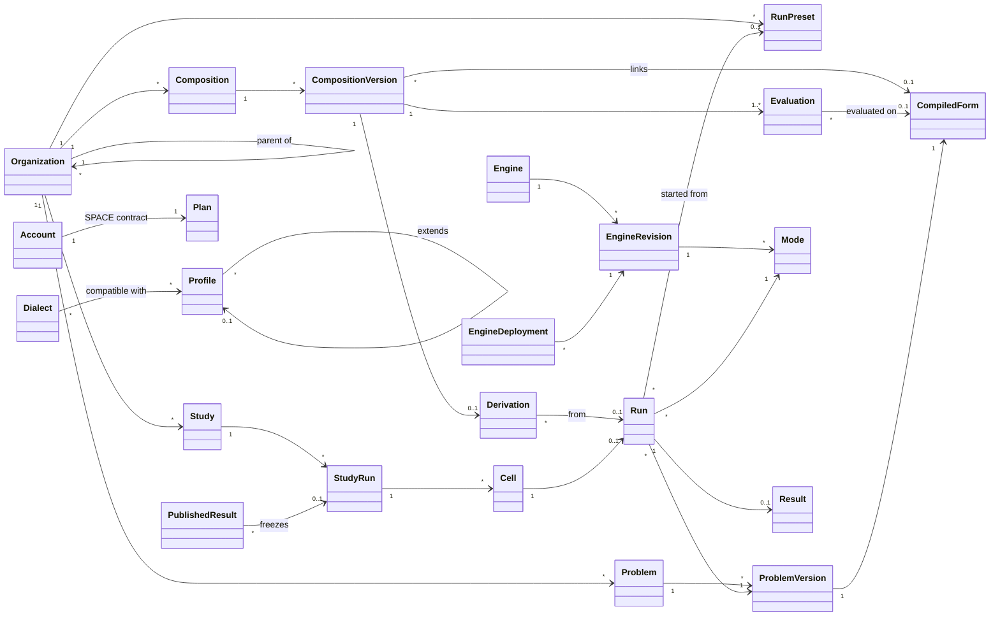
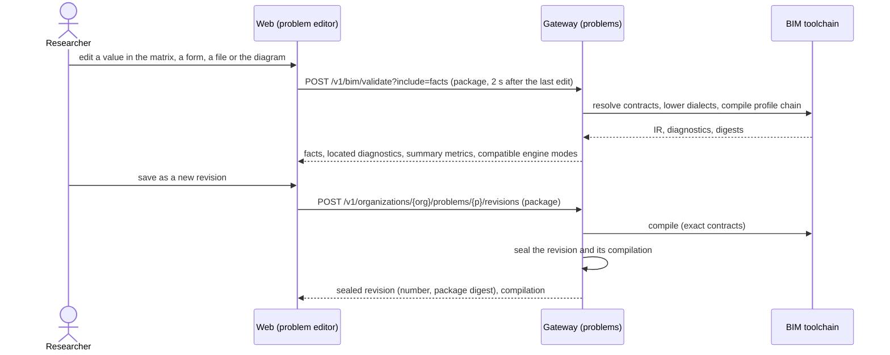
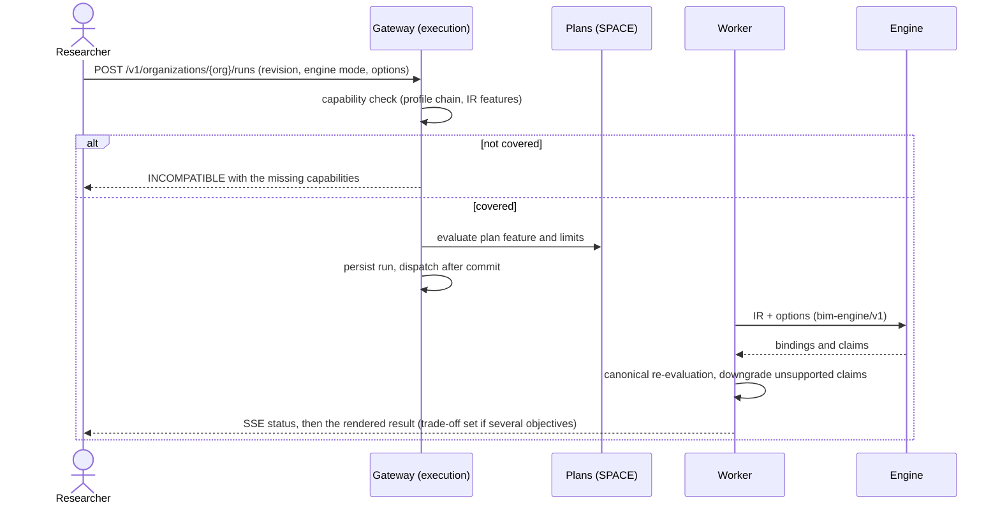
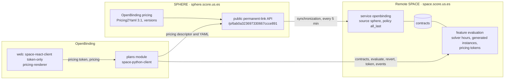

# OpenBinding architecture (target)

This document describes the architecture OpenBinding is moving to and the rules that get it there. The BIM
language is in [`BIM_V1.md`](BIM_V1.md) and [`BIM_CORE.md`](BIM_CORE.md).

Contents: 1 Principles · 2 System context · 3 Containers · 4 Backend · 5 Frontend · 6 Domain model · 7 Key flows ·
8 Language extensibility · 9 Plans (SPACE and SPHERE) · 10 Storage and retention · 11 Quality and gates ·
12 Environments and previews · 13 Repository layout · 14 Decisions

## 1. Principles that shape the architecture

1. **One canonical problem, many engines.** BIM packages compile to one canonical IR; engines receive only the IR,
   declare capabilities, and never decide the final numbers: the gateway re-evaluates every binding.
2. **Modular monolith, hexagonal inside.** One deployable gateway split into bounded-context modules; each module
   keeps its domain free of frameworks and reaches the outside world through ports.
3. **Everything external behind a port, everything shared behind a contract.** BIM toolchain, engines, SPACE,
   SPHERE, CAS, blob storage and mail are adapters; contracts are versioned and tested on both sides.
4. **Render, never dump.** The frontend renders every domain object with a shared catalogue of components; source
   views are secondary.
5. **Immutable evidence, named for people and addressed by digest for machines.** Problem versions,
   compiled forms, runs, study runs and published results are sealed; permanent links and digests make them citable
   and verifiable. Screens name them by name, version number and date; a digest appears only where verifying is the
   task (§5.4).
6. **Small, reversible steps.** The target is reached by strangling the current code module by module, never by a
   rewrite.
7. **Small surface.** Every module, endpoint and screen serves a user journey; what none needs is
   retired before anything is moved or polished.
8. **One way to deploy.** Docker Compose runs every environment, production included.

## 2. System context



SPHERE and SPACE are separate deployments of the group. The OpenBinding pricing is written and versioned in SPHERE
at `sphere.score.us.es`, under the permanent link `https://sphere.score.us.es/p/6ab0a323697330667ccce891`, and
every environment reads it there through SPHERE's public API. SPACE follows that permanent link and operates
subscriptions. OpenBinding uses the remote SPACE at `https://space.score.us.es` in every environment; no SPACE runs
inside any stack (§9.4). OpenBinding never writes to SPHERE and never re-implements SPACE (§9).

## 3. Containers



| Container | Responsibility | Technology |
|---|---|---|
| Web app | every screen; renders, never dumps; gates UI features with the pricing token | React 19, Vite, TypeScript, Recharts, `pricing-renderer`, `space-react-client` |
| Gateway API | `/v1` HTTP API, authentication, authorization, all use cases | Python 3.11, FastAPI, SQLAlchemy async, Alembic |
| Workers | runs, study cells and their metrics, generation, retention and reconciliation jobs | Dramatiq over Redis |
| PostgreSQL | operational source of truth | PostgreSQL 16 |
| Redis | queues, leases, caches (including the SPACE client cache) | Redis 7 |
| Blob store | content-addressed bytes (packages, uploads, logs, exports) | filesystem volume; S3-compatible later |
| BIM toolchain | compile, evaluate and re-evaluate BIM, in process in the gateway, the workers and the seed (`bim_client.InProcessBim` behind `BimPort`); not a container of OpenBinding | wheels of a release of `javiercavlop/bim-toolchain` (private; to the SCORELabUS organization when public). Its `bim-service` (HTTP) is a separate deployable of that repository; the gateway has no setting to use it |
| Engines | solvers behind `bim-engine/v1`; built-in ones run beside the gateway, federated ones anywhere | Node/TypeScript (MiniZinc), Java |

Every container is a Docker Compose service (§12), except SPACE, which is remote (`space.score.us.es`). The lab only
has the one-shot `pricing-bootstrap`, a separate compose project that prepares the remote SPACE (§9.4).

## 4. Backend: a modular monolith

### 4.1 Modules (bounded contexts)

| Module | Owns | Main ports used | Code today (to move) |
|---|---|---|---|
| `identity` | accounts, sessions, passwords, API keys, external identities (CAS) | `IdentityProvider` (CAS), `Mailer` | `routes/auth.py`, `routes/users.py`, `routes/cas.py`, `cas.py`, `security/*` |
| `collaboration` | organizations (nested, the only container), memberships, roles, invitations, audit, notifications | — | `collaboration.py`, `routes/organizations.py`, `repositories/organizations.py` |
| `problems` | problems of an organization, their sealed revisions (the uploaded `.bim.zip` and its digests) and compilations (one per revision and toolchain, insert-only), the stateless BIM services (`/v1/bim/validate`, `/v1/bim/templates`) | `BimPort`, `BlobStore` | `modules/problems` (domain, application, adapters; F0b); `integrations/bim*.py`, the engine protocol document in `services/engines.py` |
| `engines` | engine revisions, modes and manifests, federated deployments, conformance, capability matching | `EngineTransport` | `services/engines.py`, `services/engine_registry.py`, `services/probe.py`, `v1/remote.py` |
| `execution` | runs of an organization: submission, idempotency, dispatch, leases, cancellation, events, re-evaluation, results (with the trade-off set of a multi-objective run), neighbourhood; run presets (F1) | `EngineTransport`, `BimPort`, `PlanPort` | `modules/execution` (the run request and the runs API `/v1/organizations/{org}/runs`; F0b); `services/job_submission.py`, `services/execution.py`, `jobs/*`, `job_dispatch.py`, `worker.py` |
| `compositions` | compositions of an organization, their sealed versions (canonical Composition2Yaml bytes), their evaluations (one per toolchain, or one declared) and derivations, forks into another organization, and the stateless language services (`/v1/compositions/validate`, `parse`, `serialise`, `diff`, `schema`). The language itself is the pure library `openbinding_gateway/composition` (contract `composition-library-pure`) | `BimPort`; `problems` and `execution` application APIs | `modules/compositions` (F1) |
| `laboratory` | studies of an organization (the editable matrix inline), study runs that freeze their definition and pin each revision's compilation, cells, protocol metrics, trade-offs across engines | `execution` application API | `studies.py`, `study_jobs.py`, `routes/studies.py` (`/v1/organizations/{org}/studies`; F0b); the generator moved to QACOForge; the decision-space workspace (`analysis_jobs.py`, analysis routes, analysis queue and worker) was removed by M9.6 |
| `publishing` | published results (a frozen study run), citations, Zenodo-ready export | application APIs of `problems` and `laboratory` | none: the reports, their publications and Explore were removed in F0a |
| `plans` | the SPACE port, the entitlement map, the pricing descriptor, plan changes and eligibility (RESEARCH through CAS) | `PlanPort` (SPACE), `PricingSource` (SPHERE public API) | `modules/plans` (entitlement map, per-account quotas, the package copy of the pricing; F0b); `space_client/*`, `services/entitlements.py`, `access/policy.py`, `access/contracts.py`, `domain/entitlements.py`. Local metering and billing sponsorship were removed in F0b |
| `administration` | users, queues and engine health, storage and retention, audit, moderation of public content | application APIs of the other modules | `routes/admin.py`, `telemetry.py` |
| `shared` (kernel) | settings, logging, problem+json errors, pagination, digests, clock, ids, mail, content-addressed blobs | — | `modules/shared` (blobs; F0b), `core/*`, `mailer.py`, `security/bodylimit.py` |

### 4.2 Layout and dependency rules

```
openbinding-gateway/src/openbinding_gateway/
  app/                 composition root: create_app, lifespan, router registration, middleware, worker entry
  shared/              kernel (no imports from modules)
  modules/
    <module>/
      domain/          entities, value objects, policies; pure Python, no I/O
      application/     use cases, commands and queries, ports (typing.Protocol), public API (__init__.py)
      adapters/
        http/          FastAPI routers, Pydantic request/response schemas, problem mapping
        persistence/   SQLAlchemy models of the tables the module owns, repositories
        <external>/    space/, sphere/, bim/, engines/, cas/, blobstore/, adapters/
```

- Inside a module: `adapters → application → domain`. `domain` imports nothing from frameworks or adapters.
- Between modules: only through the other module's `application` public API, or through in-process domain events
  (audit, notifications, cache invalidation). No cross-module ORM joins; each table has one owning module.
- Modules form layers, and a module imports only modules below it: `administration` → `laboratory`
  → `compositions` → `execution` → `engines` | `problems` → `collaboration` → `identity` → `plans` → `shared`
  (`|` marks independent siblings). `compositions` sits above `execution` because a composition is derived
  from a run, and below `laboratory` because a study's trade-off set becomes compositions.
- External systems only through ports: `BimPort` (exists), `PlanPort`, `PricingSource`, `EngineTransport`,
  `BlobStore`, `IdentityProvider`, `Mailer`, `Clock`.
- Patterns: ports and adapters; application services as use-case functions; repositories with a unit of work per
  request (SQLAlchemy session); domain events for side effects; dispatch after commit (exists for runs); strategy
  for engine transports (built-in, federated).
- Enforcement: the empty packages `openbinding_gateway/app`, `shared` and `modules` exist, with import-linter
  contracts in `openbinding-gateway/importlinter-modules.ini`: `kernel` (`shared` imports no module, composition
  root or legacy layer), `composition-root` (modules and shared do not import `app`), `no-legacy-http` (modules
  do not import `routes` or `main`), `module-layers` (the order above, `exhaustive`), `module-inside`
  (`adapters → application → domain`) and `pure-domain` (no framework, client or adapter in `domain`). Run them
  from `openbinding-gateway` with
  `uv run --locked --extra test --group lint lint-imports --no-cache --config importlinter-modules.ini`.
  import-linter cannot express "other modules only through `application`" per module pair, so
  `openbinding-gateway/tests/test_modules_cross_import.py` (AST, in the gateway pytest suite) enforces it;
  `tests/test_modules_skeleton.py` checks the structure of the contract file and also runs `lint-imports` against
  planted violations (the teeth test); it is skipped where `lint-imports` is not installed (the CI `test` job syncs
  only `--extra test`); the CI `lab` job runs the contracts as a blocking step, with the `lint` group.
  The legacy `.importlinter` stays report-only and unchanged, next to the existing `tests/test_architecture_layers.py` ratchets.

### 4.3 Migration: strangler, one module at a time

0. Retire first. The decision-space workspace, the report editor, the library as a catalogue (organization
   library, project resources, project library), the composer and sponsorship lose their screens, then their
   endpoints, then their code, so nothing retired is ever moved. Done by M9.6 (2026-10-27): the owner skipped the
   `Deprecation`/`Sunset` period because nothing ran in production, and the 41 operations are removed. The data of
   the retired features was dropped with them, and the tables they left behind (reports, publications, collections,
   report evidence) went with the one-revision baseline of F0b. The versioned-artifact store itself, the read-only
   library and the project resources went in F0b too, once study runs froze their own definitions (D7), and so did
   projects and public read, once nothing pointed at a project: the organization is the only container (F0b B8).
1. Create `app/`, `shared/` and `modules/` with import-linter contracts; move nothing. Packages and contracts exist
   (§4.2); the blocking CI step is pending.
2. New capabilities land directly in modules: `plans` (M4) and the language registry (M5) are the first.
3. Move existing code one module per `refactor/<id>` change, behind characterization tests, keeping
   `docs/openapi.json` byte-identical. Order: plans → problems → engines → execution → laboratory → publishing →
   collaboration → identity → administration.
4. Each move deletes the old path, shrinks `ALLOWED_LEGACY`, `GATE_LIFECYCLE_LEGACY` and `MAX_LINES`, and ends
   with `routes/v1.py` and `main.py` reduced to composition.

## 5. Frontend

### 5.1 Layout and layers

The tree F2 built ([ADR 0050](adr/0050-frontend-layers-and-sphere-reuse.md)). The layers exist where new code lives;
the older folders are rewritten area by area.

```
frontend/src/
  routes/                 the route registry: one area file per part of the site (public, auth, account, organizations,
                          compositions, problems, engines, admin), one live('id', '/path', …) per screen
  shared/api/             openapi.ts (generated from docs/openapi.json by `pnpm gen:api`; never edited), types.ts (named
                          schemas), errors.ts (readApiError: both error envelopes, 412 with the current ETag, 429 with
                          Retry-After)
  shared/diagnostics/     Located, fromC2y and fromBim (bim.ts): one shape for every finding on screen; jsonPointer.ts
                          resolves a BIM pointer on the parsed JSON text to the range it names
  shared/editor/          the draft store (drafts.ts, useDraftStore.ts, IndexedDB) and lintScheduler.ts (debounce, abort,
                          one check of a kind at a time, Retry-After)
  shared/sphere/          text-diff.ts, requested-version.ts (verbatim); change-summary.ts, composition-fragment.ts
                          (adapted); each with its test
  shared/lib/             identity labels (§5.4) and slugs
  entities/problem/       facts.ts (the facts projection, with an ETag cache), expressions.ts
  entities/binding/       workflowGraph.ts and candidateMatrix.ts, the shared view-models; comparison.ts (the gateway's
                          comparison words)
  entities/composition/   api.ts, document.ts, values.ts, viewModel.ts, changes.ts, evolution.ts, versionRef.ts, kinds.ts
  widgets/                workflow-graph, candidate-matrix, value-badge, problems-panel, provider-map, pricing-card,
                          change-summary, evolution-charts, rules-and-objectives, composition-renderer (CompositionRenderer,
                          presets.ts and the modes)
  features/               composition-editor (code and visual Composition2Yaml editor), bim-editor (the BIM problem editor:
                          ProblemEditor, useProblemEditor, its panes, the resource forms, the BPMN modeler, matrix edits),
                          derive (DeriveCompositionDialog, and the batch of a study front), fork (ForkCompositionDialog),
                          workspace (the organization frame: breadcrumb, gate)
  pages/                  route-level screens: Compositions (list, detail and its tabs), PublicCompositions (public list,
                          showcase), Language (reference and playground), Problems (list, page and tabs, and the page
                          that mounts the problem editor), Public (the anonymous Workbench), and the older Runs, Studies,
                          Organization, Account, Admin, Engines, Home, About, Pricing, Auth
  components/, api/, utils/, contexts/
                          the older shared code: the design system (components/ui), the run-result catalogue
                          (components/rendering), the shell, CodeEditor; api/bim.ts holds the BIM validation types
                          (generated aliases, since F2b); api/client.ts keeps transport, auth, admin, engines (with
                          the engine protocol's profile types) and pricing until those areas are rewritten
```

Dependency rules, checked by `eslint-plugin-boundaries` at **error** for the new layers (`boundariesLint.test.ts`):

- `shared` imports `shared`;
- `entities` import other entities and `shared`, with no cycle;
- `widgets` import other widgets, `entities` and `shared`, with no cycle;
- `features` import `widgets`, `entities` and `shared`, never another feature; a widget that needs a feature's
  dialog takes a callback and the page mounts the dialog;
- `pages` import anything but another page. The older page-to-page edges stay warnings until their areas are
  rewritten.

The older `components/`, `api/`, `utils/` and `contexts/` count as shared. New code uses the generated types; a
drift between the gateway and the frontend fails `pnpm gen:api --check` in CI.

**One semantics.** BIM is the only problem language, and every number on screen comes from the gateway: values,
validity and violations from evaluations and `evaluate`, deltas from `neighborhood`, the size of the binding space
from the analysis, the Pareto front from study analytics. Eligibility, written candidate names and the workflow of a
problem come from the facts projection ([ADR 0048](adr/0048-problem-facts-projection.md)). The frontend formats,
groups by identical unit strings and compares identifiers; it never sums, ranks, digests or decides dominance.

**Deletion rule.** Nothing is in production: what a change replaces is deleted in that change, with no
compatibility shim, alias, redirect, re-export or deprecation. F2a deleted the Workbench's dead chart, digest and
diagnostics code, the client IR reader (`pages/Cases/bindingModel.ts`) and the client comparison words. F2b deleted
the Workbench shell (`pages/Workbench`, replaced by `features/bim-editor`), the public Workbench's client reader of BIM
source files (`pages/Public/packageModel.ts`, its diagnostics wording and result panels), the BIM types of
`api/client.ts` and the client Pareto check and CSV export ([ADR 0051](adr/0051-problem-editor-on-the-shared-core.md),
[ADR 0052](adr/0052-study-front-export-and-presets-on-the-server.md)).

### 5.2 Information architecture

- **Public header:** Home · Compositions · Language · Engines · Pricing · About · Log in. Compositions is the public
  list of every organization's public compositions (`/compositions`); a composition's public page, the
  **showcase**, is `/c/:org/:composition` (`?version=<id|label|ordinal>` is its permalink). Language is the
  Composition2Yaml reference and playground (`/language`), whose examples the gateway checks
  (`tests/composition/test_the_spec_examples.py` reads `content/composition2yaml-examples.json`). The anonymous
  Workbench stays at `/workbench`: it validates a package with its facts and draws a valid one with the shared
  workflow graph and candidate matrix, or places a refused one's findings in its files; nothing is drawn from the
  files themselves.
- **Signed in:** the header leads with the organization's Compositions, then Problems, Runs and Studies, Engines and
  Admin (administrators); "+ New" (composition, problem, study, run); the command palette (⌘K); notifications; the
  account menu (Profile · Plan · API keys · Identities · Notifications). Home shows the recent compositions of an
  organization above its recent activity.
- **Organization:** overview (its compositions first, then problems, runs, studies and sub-organizations) · Settings
  (General · Members · Run presets · Audit). An organization's screens are
  `/app/:org/{compositions,problems,problem-editor,runs,studies,settings}`.
- **Composition page:** `/app/:org/compositions/:composition/:tab?` with the tabs Overview · Editor · Versions ·
  Analysis · Settings, a version selector (`?version=`), the value status, the lineage (forked from, derived from a
  run) and, for a member, "New version" (code, visual, upload, derive) and Fork. Versions has the views table,
  compare and file (`?view=compare|file&from=&to=`) and evolution (`?view=evolution`); Analysis shows for a member
  reading a version linked to a problem it can read; Settings for MEMBER and above (visibility: ADMIN). Operations
  joins in F4.
- **Problem page:** header with the version selector; tabs Overview (workflow graph, binding space, rules and
  objectives from the facts) · Candidates (the candidate matrix; `?composition=&compositionVersion=` highlights what a
  composition version chose) · Versions · Runs · Compositions (the compositions that link it) · Source · Settings. The
  problem list filters by origin (uploaded, problem editor, QACOForge) and by linking composition.
- **Problem editor:** `/app/:org/problem-editor` (`?template=`, `?problem=&revision=`, and the composition overlay
  `&composition=&compositionVersion=`). Panes Workflow · Candidates (the matrix, edited in place) · Rules · Files ·
  Forms · BPMN, the engines beside them and the Problems panel below; on a phone every one of them is a tab. It checks
  the package live and saves it as a problem version ([ADR 0051](adr/0051-problem-editor-on-the-shared-core.md)).
- **Run page:** verdict, engine mode and budget first; then the binding table, QoS against bounds, the objective
  breakdown and engine-claimed versus evaluated values; the trade-off set when there are several objectives; "Keep it
  as a composition" (derive) for a member; the log collapsed at the bottom.
- **Study page:** Setup · Progress · Results (the gateway's Pareto front of each problem version, derive a
  composition per point, compare two, export CSV or JSON from the gateway). Runs and studies start from run presets
  ([ADR 0052](adr/0052-study-front-export-and-presets-on-the-server.md)).
- **Screen budget:** exactly **36** routed screens (`routes/screenBudget.test.ts`): F2 added the composition list
  and detail, the public list, the showcase and Language. F5 retires register, password reset and the CAS callback,
  which brings it to **33**. Each user journey has a Playwright walk of at most five screens, mocked
  (`e2e/f2a-*.spec.ts`, `e2e/f2b-*.spec.ts`) and, for J1 to J4, live against the lab
  (`e2e/live/08-derive-seal-compare.spec.ts`, `09-public-fork.spec.ts`, `10-problem-editor.spec.ts`,
  `11-study-front.spec.ts`).

### 5.3 Rendering catalogue

The composition core ([ADR 0049](adr/0049-composition-renderer-core.md)): `entities/composition/viewModel.ts` turns
gateway answers into a `CompositionViewModel`, and `CompositionRenderer` draws one **mode** of it. Each mode's
sections are a preset in `presets.ts`; a screen narrows them with `hideSections`, `density` and `onlyDifferences`.
Presentation hints live there and in per-viewer `localStorage` preferences, never in the document or on the
composition.

| Mode | Shows | Data | Used in |
|---|---|---|---|
| `catalog` | identity, value status, values, binding, offering, evidence, problem, the evaluation's findings (members) | the composition, the version with `include=document` | Overview |
| `architecture` | providers and the upstream SPHERE plan references | the document, the facts of the evaluated compilation, `analytics` | Overview |
| `workflow` | the workflow with each task's candidate, the problem's candidates (members) | the document, the facts | Overview |
| `comparison` | the change summary, the later workflow with changes marked, the candidates each version chose; the file diff | `GET …/diff`, both versions' content and documents | Versions (compare, file) |
| `calculator` | every one-task move with the gateway's comparison word and deltas | `GET …/neighborhood` | Analysis |
| `configurator` | another binding chosen per task and what the toolchain makes of it | `POST …/evaluate` | Analysis |
| `showcase` | the public page: header, what it does, value status, values, workflow, providers, plans, the problem's reference, offering, versions | the redacted public reads | `/c/:org/:composition` |

The editor is a feature, not a mode: `features/composition-editor` (CodeMirror YAML with the gateway's lint and
completion from the problem, the visual form, the Problems panel, the seal bar) on the draft store.

| Component | Shows | Used in |
|---|---|---|
| `WorkflowGraph` | a Composition2Yaml workflow (seq, and, xor with probabilities, loop) as nested groups, each task with its candidate and status in words | problem Overview, composition Overview, both editors, comparison, showcase, public Workbench |
| `CandidateMatrix` | tasks × candidates × features from the facts, units in headers, the selected candidate marked, cards below 640 px; `select` mode for choosing, `edit` mode for the problem editor's cells | problem Candidates, composition Overview, both editors, configurator, public Workbench |
| `ValueBadge` | Verified · Declared · Unverified, always in words, and a value's origin | every composition screen |
| `ProblemsPanel` | located findings as buttons that jump to the place, counts announced, grouped by file for a BIM package | both editors, Language, derive preview, catalog and public Workbench (read-only) |
| `RulesAndObjectives` | the rules (must or should), objectives and penalties of the facts, each rule with where the package writes it | problem Overview, problem editor (Rules) |
| `ProviderMap`, `PricingCard` | tasks grouped by provider; a plan's reference face, or pricing-renderer when given Pricing2Yaml (F3) | composition Overview, showcase |
| `ChangeSummary` | what changed between two versions, or "Not comparable: <reason>" | Versions |
| `EvolutionCharts` | structure and values per version over time, verified, declared and unverified apart, problem and compilation changes marked, a table for each chart | Versions (evolution) |
| `MetricCards` | a row of key numbers with units | dashboards, headers |
| `BindingTable`, `QoSAgainstBounds`, `ObjectiveBreakdown`, `EvaluationDiff`, `TradeOffChart`, `RunResult` | the run result: binding, QoS against bounds, objective terms, claimed against evaluated values, the trade-off set | run page, study cell |
| `VerdictBadge` | OPTIMAL · FEASIBLE · UNSAT · TIMEOUT · INCOMPATIBLE | everywhere a run appears |
| `BindingSpaceBadge` | the size of the binding space the analysis gives | problem pages, problem editor, public Workbench, study analytics |
| `CodeEditor` | CodeMirror (JSON, YAML, XML) with located diagnostics and completion | editors, Language |
| `LogPanel` | collapsed, searchable, downloadable log | run result, admin errors |
| `SourceView` | read-only code viewer with copy and download | Source tabs, examples, previews |

Charts use Recharts. A hygiene test forbids rendering `JSON.stringify` output or `<pre>` outside `SourceView` and
`LogPanel`, and digest-shaped text outside the components that §5.4 allows. Every new component is usable on a phone
(390 px) and by keyboard and screen reader; the live visual QA (`e2e/live/visual-qa.spec.ts`) measures overflow,
clipping, touch targets and errors on every screen at both sizes.

### 5.4 Identifiers on screen

People read names, machines read digests.

| Thing | Shown as | Not shown |
|---|---|---|
| Problem version | `checkout-flow` v3 · sealed 20 Aug 2026 | content or version digests |
| Run | run 14 of `checkout-flow` v3 · `minizinc-csp` 1.1.1 exact · 21 Oct 2026 | job UUID, request digest |
| Study run | `engines-vs-suite` run 3 · 21 Oct 2026 | matrix or cell fingerprints |
| Published result | its title · published 22 Oct 2026 | edition fingerprint |
| Engine | `minizinc-csp` 1.1.1 · mode exact | manifest digest |

The API keeps every digest. Export manifests are the only places that show one, as a single value with a copy
button; `SourceView` shows files as they are. UUIDs never appear in UI text; URLs
use permanent ids or slugs. The hygiene test fails on a digest-shaped string (`sha256-` or 40/64 hexadecimal
characters) or a UUID rendered anywhere else.

## 6. Domain model



Mapping to `v1` names: Problem = `BindingCase` (owned by an organization), ProblemVersion = `BindingCaseRevision` (the
uploaded package and its digests), CompiledForm = `ProblemCompilation` (its IR, per toolchain), Run = `Job` (it names a
revision and its compilation and never copies the IR), Result = job result plus re-evaluation, PublishedResult = not built
yet (F1/F9; the old `publications` table is retired). A problem version is its uploaded package, addressed by digest; there is no
component catalogue. A study run freezes its definition, with the compilation of each revision it runs. Every sealed entity has a content digest
that the API returns and Verify checks;
screens name it as §5.4 says. Permanent links address problems and published results independently of
slugs.

**As built after F0b.** The organization is the only container; the schema has 25 tables. An organization owns its
problems (`binding_cases`), their revisions (`binding_case_revisions`: the uploaded package, held by a `blobs` row of
that organization, with its digests) and their compilations (`problem_compilations`: the IR of a revision by one
toolchain, insert-only and unique by `(revision_id, compiler_digest)` and by `(revision_id, compilation_digest)`;
since F1 each row also stores the `semantic_digest` of its IR, which two toolchains that read the problem alike share). A run
(`jobs`, its creator in `created_by_id` like every other table) belongs to the organization and names a revision and a compilation through a composite foreign key, so it cannot
run another revision's IR. A study (`studies`) holds the editable definition; a study run (`study_runs`) holds the frozen
copy and its digest, and each cell (`study_cells`) pins the compilation it runs. There are no projects, no artifact store,
no snapshots and no public read. Sealed rows reject UPDATE through triggers declared once in `db/triggers.py`
(`immutable`, `protect`, `retain`); history is kept by `RESTRICT` foreign keys rather than by refusing every DELETE, so
a problem nobody ran can be deleted ([ADR 0023](adr/0023-trigger-ddl-single-source.md),
[ADR 0024](adr/0024-immutable-means-no-update.md)).

**As built after F1.** The schema has 30 tables. Five arrived with compositions and presets, and one column with the
problem link:

| Table or column | What it holds | Mutability and deletion |
|---|---|---|
| `problem_compilations.semantic_digest` | the digest of what the IR means, shared by toolchain releases that read the problem alike ([ADR 0042](adr/0042-problem-link-semantic-digest.md)) | insert-only with its row |
| `compositions` | a composition of an organization: slug, name, description, `kind`, `archived` | mutable (ETag `updated_at`); deleted by `deleteComposition` or with its organization |
| `composition_versions` | the canonical Composition2Yaml bytes of a version (inline `TEXT`, at most 256 KiB), its ordinal and label, `syntax_version`, `values_status`, content digest, the linked revision and compilation, the evidence run, the offering source, `based_on`, `forked_from` and `analytics` ([ADR 0045](adr/0045-composition-versions-canonical-bytes.md)) | insert-only (`immutable`); deleted with its composition |
| `composition_evaluations` | one evaluation per version and basis (a toolchain's `compilerDigest`, or `declared`): outcome, values with units, violations, digests, toolchain and diagnostics located in the stored bytes ([ADR 0044](adr/0044-one-evaluation-per-version-and-toolchain.md)) | insert-only; deleted with its version |
| `composition_derivations` | the edge a derived version keeps: source (`run` or `binding`), revision, compilation, binding and its digest, run and point, provenance | insert-only; deleted with its version |
| `run_presets` | an organization's named run settings: engine, registration, mode, options, optimisation | mutable (ETag); deleted by `deleteRunPreset` or with its organization |

Versions, evaluations and derivations name problem compilations (and runs) through `RESTRICT` foreign keys, so a
problem a composition links answers `409 problem_has_compositions` on delete, and the admin purge keeps the terminal
runs a version or derivation names. Deleting an organization locks its compositions before its problems and deletes
them with the subtree.

## 7. Key flows

### 7.1 Author, validate and version a problem



### 7.2 Run a problem



A run never copies the IR. `createRun` resolves the revision's compilation by compile-or-get: it is looked up by
`(revision, compilerDigest)` and compiled and stored only on a miss, once per revision and toolchain
([ADR 0027](adr/0027-compile-or-get.md)). The run records the compilation's id and IR digest; the worker loads the IR
from `problem_compilations` when it claims the job and refuses to run one whose digest differs
([ADR 0026](adr/0026-engine-ir-from-problem-compilations.md)). Re-evaluation, the neighbourhood and the IR view read the
same row, and a study run pins one compilation per revision for all its cells
([ADR 0028](adr/0028-frozen-study-definitions.md)).

### 7.3 Compose: seal, derive and evaluate a composition

```mermaid
sequenceDiagram
  actor U as Researcher
  participant G as Gateway (compositions)
  participant P as problems / execution
  participant B as BIM toolchain (BimPort)
  U->>G: POST …/compositions/{c}/versions (Composition2Yaml) or …/derive (run or binding)
  G->>G: read the document (language slot): syntax, sections, coherence, schema
  G->>P: resolve problem.ref and compilation; compile-or-get on the installed toolchain
  G->>G: semantic-digest gate; judge workflow, candidates and units against the IR's facts
  G->>B: evaluate(installed IR, binding) (evaluation slot)
  B-->>G: values, violations, or binding_invalid
  G->>P: check the evidence run's solution
  G->>G: one short transaction: lock, dedupe by content digest, insert version, evaluation, derivation
  G-->>U: version (verified or declared), evaluation, diagnostics
```

Every path that judges a composition (seal, check, derive, fork, re-evaluate, evaluate, neighbourhood) goes through
one assessment (`modules/compositions/application/assess.py`). It writes nothing; sealing then stores its result in
one short transaction. A document with a `problem` is evaluated on the installed toolchain's compilation of the linked
revision: the link holds while the semantic digests agree (an info when the named compilation is another release's),
and is refused when they differ ([ADR 0042](adr/0042-problem-link-semantic-digest.md)). Values and validity are
`BimPort.evaluate`'s, exactly as returned ([ADR 0043](adr/0043-values-only-from-bimport.md)). A document without a
problem is stored with its values declared. The language is specified in [COMPOSITION2YAML.md](COMPOSITION2YAML.md).

On the web (F2a) the same path is walked in at most five screens: the problem page (workflow and candidates from
the facts) → a run → "Derive composition" (a preview with `seal: false`, then the seal of the same request; a new
composition is created when the preview is asked for, so an abandoned derivation leaves it empty) → the Editor,
whose visual form rebinds a task and whose live check (`…/versions/check`) states the values before the next seal →
Versions, comparing the two entry by entry and line by line. A public composition is read at its showcase and
forked from there into another organization ([ADR 0047](adr/0047-public-compositions.md)).

### 7.4 Study

A study selects problem versions, engine modes, parameter sets and seeds. A study run expands the
matrix into cells, each one a run with frozen inputs; cells retry independently. Analytics read only re-evaluated
results and compute the QACOBench protocol metrics: coverage (processable over submitted), conditional binding
yield (binding-returning over processable), gap to the certified optimum, verdict reconciliation (an UNSAT proof
contradicted by a validated binding, or an OPTIMAL beaten, invalidates the run), runtime distributions and rankings.
With several objectives, the results view also shows, per problem, the trade-off set across engines. The QACOBench
harness keeps working against the public API; the study is the same protocol inside the platform.

### 7.5 Publish a result

`Publish` freezes a finished study run. The gateway seals the exact problem versions, engine
revisions, budgets, seeds and computed metrics into a published result with a permanent link, a digest and a
citation, and offers a Zenodo-ready export (results as CSV and JSON plus a manifest with every digest). A published
result is never edited: a correction is a new published result that names the one it corrects, and withdrawal hides
it from Explore while its permanent link keeps answering (§10). There is no document editor; the text of a paper lives
in the paper.

### 7.6 Plans

See §9.

## 8. Language extensibility

### 8.1 Layers

| Layer | Owns | Changes how |
|---|---|---|
| BIM core | envelope, `Instance`, role-indexed resources, references, digests, provenance | BIM MAJOR/MINOR release only |
| Profile | a problem family: roles and cardinalities, resource types per role, output IR schema, capability vocabulary, limit vocabulary, evaluation semantics, adapter; **may extend one other profile** | new profile version |
| Dialect | a concrete syntax for resources of one or more profiles (media type, schema or XML root), lowered to the profile's canonical resource types or to declared extension points | new dialect version |
| Adapter | the lowering (and, for profiles, compile hooks and evaluator plug-ins) | new BIM release (§8.3) |

### 8.2 Profiles that extend profiles

A profile may declare `extends: {namespace, name, version, digest}` (single inheritance). The child inherits the
parent's roles, cardinalities, resource types, vocabularies and output schema, and may:

- add roles and resource types, and tighten (never loosen) cardinalities;
- add capability dimensions and values, and limit names;
- extend the output IR with new sections described by a schema delta, without changing the meaning of any parent
  field;
- add evaluation semantics (constraints, aggregation operators, objective terms) implemented in the canonical
  evaluator, so the gateway can re-evaluate every binding;
- add compile hooks: deterministic pre-solve transforms from extension resources to features or constraints.

Compilation resolves the chain from the root, validates roles and cardinalities against the merged contract, lowers
dialects, runs the parent's lowering, then each child's lowering and hooks, validates the merged output schema and
records the whole chain, every adapter digest and the compiler digest in the IR.

**Placement becomes the reference extension.** `qos-binding-placement/v1` is re-declared as a profile extending
`qos-binding/v1`. It adds the `Placement` resource type in the `candidateCatalog` role (pools, capacities, network
latencies, events, transitions, global latency: the `R` and `L` of the CLASP model), its capability dimension and
evaluator semantics. Its output keeps today's `BindingProblem.spec.placement` shape, so engines, goldens and digests
of existing placement problems do not change; only the declaration moves from the core profile into the extension.
A pricing-aware profile (candidates as subscriptions; iPricings plus expected consumption compiled to cost features,
as in CLASP and PACO) is the next candidate. A domain that fits the core without new semantics — quantum resource
selection — needs no extension at all: it is plain BIM data.

### 8.3 Adapters

Every adapter is built in: reviewed Python in `bim-toolchain` (qos-binding, placement, BPMN), shipped with a BIM
release and guarded by code review, goldens and consumer contracts. The gateway keeps no registry of dialects or
resources and takes no submissions: what it compiles is what the installed `bim-toolchain` release ships.

### 8.4 Language API

| Operation | Purpose |
|---|---|
| `GET /v1/language` | overview: BIM core version, compiler digest, installed profiles and dialects, counts |
| `GET /v1/language/profiles`, `.../profiles/{namespace}/{name}`, `.../versions/{version}` | profiles with their chain, roles, capabilities, schemas and supporting engines |
| `GET /v1/language/dialects` (same shape) | dialects |
| `GET /v1/language/schemas/{kind}` | schemas (download) |
| `POST /v1/language/compile` | compile a package or an exact problem version: diagnostics, summary metrics, compatible engine modes |

Today the gateway serves `GET /v1/engines/protocol` (the installed Profiles with the engine protocol digest, read by
the engine registration form), `GET /v1/bim/templates` and `POST /v1/bim/validate` (the problem editor checks there
live and saves through the problems API, `POST /v1/organizations/{org}/problems` and `…/revisions`; the public
Workbench validates there on demand). `GET /v1/profiles`,
`GET /v1/dialects`, `/v1/examples`, `/v1/validate`, `/v1/instances` and `/v1/snapshots` were removed in F0b, with
no deprecation period. The registry routes (`POST /v1/dialects`, `/v1/resources`, their
approvals), `/v1/schemas/{kind}`, `/v1/catalog` and the deprecated pricing YAML proxy `GET /v1/pricing` were removed in
F0a.

### 8.5 Developer kit

`bim-toolchain` ships a `bim-ext` command: `new` (scaffold a dialect or profile), `test` (schemas, golden examples,
double lowering) and `pack` (extension package and digest), plus a template repository and a how-to in `docs/`. A
dialect reaches the gateway in a `bim-toolchain` release, never through an upload.

## 9. Plans: SPACE and SPHERE

### 9.1 Topology



| Who | Responsibility |
|---|---|
| SPHERE (`sphere.score.us.es`) | authoring and versioning of the OpenBinding pricing; public permanent-link API |
| SPACE | contracts, feature evaluation, the solver-hours and generated-instances usage levels, contract migration when the pricing changes, events |
| OpenBinding | enforcement points and its own counts for the other limits, contract creation (registration, CAS link), plan changes for FREE and RESEARCH and by administrators, pricing display, token issuance to the browser |

| Environment | SPHERE | SPACE |
|---|---|---|
| Unit tests and CI | a recorded copy of the pricing in `tests/fixtures`; no network | a fake `PlanPort` or `OpenGate` |
| Lab, develop preview | `sphere.score.us.es`, read only | `space.score.us.es` |
| Production | `sphere.score.us.es` | `space.score.us.es` |

### 9.2 Gateway side

- `modules/plans` implements `PlanPort` with `space-python-client` 1.x (asynchronous transport, Redis cache provider)
  and a MANAGEMENT-scoped key; `OpenGate` remains for development and tests and is refused with `APP_ENV=prod`.
- The **entitlement map** (operation → SPACE feature id `openbinding-<name>` and limits) lives in
  `modules/plans/domain/entitlement_map.py`, the only place the ids are spelled. **Delivered (F0b):** at start-up
  (`main.check_pricing`) the gateway reads the published pricing (from SPACE, or a package-data byte copy under the
  open gate), refuses to start when a feature or limit it references is missing or not `NUMERIC`, and, with SPACE
  enabled, requires `SPACE_ORGANIZATION_ID` and the `pricing-token-jwks` capability (fatal under `APP_ENV=prod`, a
  warning elsewhere). Pricing tokens are verified against SPACE's JWKS and matched to the account with
  `pricing_token_user_id`; there is no unverified fallback. The same check on `pricing_activated` moves to F3/F8,
  with the `PricingSource` port and the SPACE ledger.
- Quotas are per account (`modules/plans/domain/quotas.py`); organizations carry no billing sponsor.
- Pricing 0.2.0 (`docs/pricing/`) declares seven features and twelve limits. SPACE tracks two usage levels, both
  renewable and monthly: `solverHours` and `generatedInstances`. A run on a built-in engine, a study cell or the
  solver part of a solver-aware generation is admitted while the month's hours are not exhausted and then consumes
  its time budget; a run that stops early is not refunded, so the count can be checked against the budgets. A
  generation is admitted while the month's instances are not exhausted and consumes the instances it writes. The
  other limits are plan values that the gateway compares with its own counts (running runs, cells of a study run, a
  run's budget, instances per generation request, problems and collections owned, repository storage, federated
  engines, API keys), so no counter can drift. The repository limits apply to FREE only; the
  other plans declare them as `.inf`.
- Gated operations call `evaluate(user, feature, expected_consumption)`; an operation that fails after consuming
  calls `revert_evaluation` (SPACE honours it within two minutes).
- SPACE events (`synchronized`, `pricing_created`, `pricing_activated`, `pricing_archived`, `service_disabled`)
  invalidate caches and are relayed to browsers as a `plans.changed` notification.
- `GET /v1/plans/pricing` (public) returns the pricing descriptor (permanent link, SPHERE version id and label,
  content hash, the version SPACE has activated) and the YAML read from SPHERE's public API
  (`/api/v1/public/pricings/{pricingId}` and `.../versions/{versionId}/yaml`, bounded to 5 MiB, hash-verified,
  ETag-cached). OpenBinding holds no SPHERE key.
- Removed: `sphere_client.py`, `pricing_catalog.py`, the deprecated `/v1/pricing` proxy and `/v1/pricing/catalog`,
  admin pricing validation, `space_client/deployments.py`, the release sweeps, local metering
  (`domain/usage_counters.py`) and the sponsorship capacity checks.

### 9.3 Browser side

- `SpaceProvider` with `allowConnectionWithSpace: false`; the token comes from `GET /v1/users/me/pricing-token` and is
  refreshed on sign-in, on plan change and on `plans.changed`. No SPACE key ever reaches the browser.
- `<Feature id="openbinding-…">` gates UI; the server enforces the same decision.
- The Pricing page and the account Plan page render the pricing with `pricing-renderer` (React adapter, themed with
  the OpenBinding tokens); signed-in users see their plan selected; FREE, and RESEARCH for accounts with a
  Universidad de Sevilla CAS identity, change self-service; LAB shows "Contact us".
- An administrator confirms a change of somebody's contract (admin-user-detail) from the change review of
  `pricing-renderer` (`compareSelections` and `PricingChangeReview`, loaded on demand): plan, price, add-ons, features
  and limits before and after, both read from the catalog, without the Upgrade/Downgrade badge, since the plans are
  not a ladder. It sends the request the form always sent (`POST /v1/admin/users/{id}/subscription`, or `/plan`), with
  the `ETag` of the subscription the review was drawn from as `If-Match`. A subscription that has moved since (`412`, or
  `409 contract_changed` for a change that named no revision) is said in the review, read again, and the review is drawn
  again from it; only the administrator sends the change again.
- `space-react-client` 0.4.0, like 0.3.3 before it, declares React ^18.3.1; OpenBinding runs React 19. A spike
  validates it in token-only mode; if it fails, the fix is proposed upstream to `Alex-GF/space-react-client` rather
  than forked.

### 9.4 The remote SPACE linked to the remote SPHERE

No SPACE and no SPHERE run in any stack. OpenBinding uses the remote SPACE at `https://space.score.us.es`, which
follows the SPHERE permanent link. The lab has one optional compose project, `compose.lab-pricing.json`, with a
one-shot `pricing-bootstrap` (`mem_limit` 96 MiB, no database, no volume, no published port; see
`docs/qa/PRICING_PROFILE.md` (removed with the factory artifacts in `e47da50d5`; in git history)). It takes a MANAGEMENT key of the remote SPACE from
`DEMO_SPACE_MANAGEMENT_KEY`, supplied by the lab supervisor from a root-only secret file outside the repository, and
in two steps:

1. creates the `openbinding` service from the SPHERE permanent link (`source: sphere`, `policy: all_last`) if it is
   missing;
2. creates the contracts of the synthetic users of the seed.

The synthetic contracts live in a SPACE shared with other projects of the group. The remote SPACE keeps synchronizing
with the permanent link, so a new public version of the pricing migrates the contracts without any change in
OpenBinding. The stack needs outbound HTTPS to `space.score.us.es` and `sphere.score.us.es` only. The version of the
remote SPACE and its routes are unverified until the first live run of the one-shot.

## 10. Storage and retention

| Data | Where | Retention |
|---|---|---|
| Sealed problem versions, compiled forms, published results | PostgreSQL + blob store | permanent; withdrawal hides, never deletes |
| Frozen study-run definitions (with the compilation each revision runs) | PostgreSQL | permanent, with their study run |
| Drafts | PostgreSQL | until deleted; owner notified after 180 idle days |
| Runs and results | PostgreSQL + blob store | permanent while part of a study run or a published result; otherwise 365 days |
| Raw engine logs | blob store | 90 days unless the run belongs to a published result |
| Uploads not referenced by any version | blob store | 30 days |
| Notifications | PostgreSQL | 180 days |
| Audit events | PostgreSQL | permanent |
| Develop preview | lab Docker volumes | permanent |
| Datasets, raw campaign results | Zenodo | never in Git or the platform database |

Purges run through `/v1/admin/maintenance/preview|purge` and scheduled workers.

Package files are content addressed and shared across organizations, so no request handler ever unlinks one: a request
that did could race with another organization's uncommitted upload of the same bytes, and a rolled-back delete would
still lose the file. A blob row is unique per organization and digest and is only file storage (no public route, no
quota meaning). Deleting a problem deletes rows and leaves the blob rows; deleting an organization deletes its blob
rows; a later sweeper reclaims files no committed row references ([ADR 0032](adr/0032-blobs-are-file-storage.md)).
Storage is charged per revision, to the account that created it ([ADR 0035](adr/0035-storage-charged-per-revision.md)).

The schema is one Alembic revision, the baseline that `openbinding-gateway/tools/rebaseline.py` generates from the
models and from the trigger declarations of `db/triggers.py` (the only source of trigger DDL). A schema change edits
the models and regenerates the baseline under a new revision id; nothing is in production, so there are no
incremental migrations, and a database built from an older baseline is refused and rebuilt (README, "Reset the dev
database"). `tests/test_schema_baseline.py` keeps the baseline, the models and the triggers equal.

## 11. Quality architecture

| Level | What | Where |
|---|---|---|
| Acceptance | executable scenarios from the public interfaces: API flows with pytest, UI flows with Playwright | `acceptance/api/`, `acceptance/ui/` |
| Unit and property | pytest, Hypothesis, Vitest | per package |
| Contract | OpenAPI snapshot, JSON Schemas, BIM and engine consumer contracts; SPHERE against a recorded pricing in CI and `sphere.score.us.es` in the lab | CI and lab |
| Static | ruff, mypy (ratcheted), ESLint, import-linter, boundaries | CI |
| Preview | lab deployment, Playwright flows, screenshots (desktop and mobile) | NiPoGi lab |

## 12. Environments and previews

| Environment | Where | Compose files | Data | Purpose |
|---|---|---|---|---|
| Development | developer machine | `docker-compose.yml` (profile `dev`) | synthetic | build and unit tests |
| Lab | NiPoGi rootless lab Docker | `compose.lab*.json` profiles | synthetic seed | integration, e2e |
| Develop preview | NiPoGi lab, follows `develop`; `https://openbinding.home.javiercavlop.com` | the lab files | synthetic seed | the owner reviews `develop` from the Mac or the iPhone |
| Production | Universidad de Sevilla servers (`openbinding.score.us.es`) | `deploy/compose/production` overlay | real | only on the owner's order |

Docker Compose is the only deployment tool: one base definition and an overlay per environment, images
pinned by digest, secrets mounted as files, health checks on every service, PostgreSQL backups by a scheduled
`pg_dump` service and volume snapshots. There are no Kubernetes manifests.

The develop preview sits behind the homelab Caddy (TLS, home network and WireGuard VPN only) with an AdGuard
rewrite; web and API share its origin (`/api`), so no CORS entry is needed.

## 13. Repository layout

The application directories keep their names; the clutter at the root moves:

| From | To |
|---|---|
| `compose.lab*.json`, `compose.pgtest.json` | `deploy/compose/` |
| `docker-compose.yml` | stays at the root as the development entry point |
| `deploy/kubernetes/` | removed |
| `nginx/`, `up.sh` | `deploy/` |
| `pricings/` (FaaS iPricings of CLASP) | `experimentation/clasp/pricings/` |
| `output/` (Zenodo packaging of QACOBench 1.1.1) | removed (it remains at the tag `pre-redesign`) |
| `datasets/` (QACOBench sources and transformers) | moved to QACOForge (`datasets/`) |
| `experimentation/qacobench/`, the generator (`/v1/generator`, `engines/bim-generator`) | removed: extracted to `javiercavlop/QACOForge` (private; QACOBench 1.1.1 reproduces from the tag `pre-redesign`) |
| — | `acceptance/` (new), `deploy/compose/production/` (new), `docs/pricing/` (OpenBinding's pricing proposals and their rationale; SPHERE holds the published versions) |
| the `bim-toolchain` directory | removed: extracted to `javiercavlop/bim-toolchain` (private; to the SCORELabUS organization when public), consumed as release wheels pinned in `openbinding-gateway/uv.lock` |

Each move is one `refactor/<id>` change that updates CI, Dockerfiles, documentation links and tests together.

## 14. Decisions

| ADR | Decision |
|---|---|
| [0022](adr/0022-one-schema-baseline.md) | one schema baseline, regenerated by script (D1) |
| [0023](adr/0023-trigger-ddl-single-source.md) | trigger DDL has one source, `db/triggers.py` (D2) |
| [0024](adr/0024-immutable-means-no-update.md) | immutable rows reject UPDATE; history is kept by `RESTRICT` foreign keys (D3) |
| [0025](adr/0025-workbench-stays-bim-editor.md) | the Workbench stays as the BIM problem editor (D4); superseded by 0051 |
| [0026](adr/0026-engine-ir-from-problem-compilations.md) | a run executes the IR of its compilation and never copies it (D5) |
| [0027](adr/0027-compile-or-get.md) | compile-or-get, keyed by the compiler digest (D6) |
| [0028](adr/0028-frozen-study-definitions.md) | study runs freeze their definitions and pin compilations (D7) |
| [0029](adr/0029-no-run-presets-in-f0b.md) | no run presets or execution configurations in F0b (D8) |
| [0030](adr/0030-run-columns.md) | the columns of a run (D9) |
| [0031](adr/0031-engine-protocol-endpoint.md) | `GET /v1/engines/protocol` replaces `/v1/profiles` (D12) |
| [0032](adr/0032-blobs-are-file-storage.md) | blobs are file storage; requests never unlink files (D14) |
| [0033](adr/0033-pricing-entitlement-map.md) | pricing 0.2.0 through one entitlement map (D15) |
| [0034](adr/0034-no-public-read-in-f0b.md) | no public read in F0b (D17); superseded for compositions by 0047 |
| [0035](adr/0035-storage-charged-per-revision.md) | storage is charged per revision (D23) |
| [0036](adr/0036-bim-services-under-v1-bim.md) | the BIM language services live under `/v1/bim` (D25) |
| [0037](adr/0037-anonymous-workbench-stays.md) | anonymous validation at `/workbench` stays (D26) |
| [0038](adr/0038-old-composition2yaml-removed.md) | the problem-authoring Composition2Yaml is removed (D27) |
| [0039](adr/0039-drop-v1-job-provenance.md) | `v1_job_provenance` is dropped (D28) |
| [0040](adr/0040-deleted-accounts-deactivate-engines.md) | a deleted account's federated engines are deactivated (D29) |
| [0041](adr/0041-composition2yaml-final-composition.md) | Composition2Yaml is the document of a final composition (F1 D1-D6) |
| [0042](adr/0042-problem-link-semantic-digest.md) | a composition links a problem by its semantic digest, and is evaluated on the installed compilation (F1 D7) |
| [0043](adr/0043-values-only-from-bimport.md) | global values and binding validity come only from BimPort, exactly as returned (F1 D5, D10) |
| [0044](adr/0044-one-evaluation-per-version-and-toolchain.md) | one evaluation per version and toolchain; the offering is a reference with one source (F1 D8) |
| [0045](adr/0045-composition-versions-canonical-bytes.md) | composition versions are canonical bytes in the row, sealed in two phases, read back in stored mode (F1 D11, D14, D20, D21) |
| [0046](adr/0046-compositions-module.md) | the compositions module, its access rule and key permissions, and run presets in execution (F1 D12, D16-D18) |
| [0047](adr/0047-public-compositions.md) | public compositions: visibility, the read rule with `get_reader` and one 404 body, redaction by the bytes, lineage, the catalog, caching and the visitors-only budget (F2 C1-C3, D3, D19-D22) |
| [0048](adr/0048-problem-facts-projection.md) | one facts projection of a compiled problem, with the workflow in Composition2Yaml's shape and the naming rule in the gateway (F2 D4, D9, D25) |
| [0049](adr/0049-composition-renderer-core.md) | the composition renderer: a headless core, modes over gateway data, stored documents, no client semantics, hints outside the document (F2 D5, D6, D14) |
| [0050](adr/0050-frontend-layers-and-sphere-reuse.md) | frontend layers, generated API types and the SPHERE copies (F2 D7, D12, D13, D24) |
| [0051](adr/0051-problem-editor-on-the-shared-core.md) | the BIM problem editor on the shared core: the matrix from the last checked facts, edits written through origins, live checks within the compile budget, one undo history; the Workbench deleted (F2 D9, D11, D15; supersedes 0025) |
| [0052](adr/0052-study-front-export-and-presets-on-the-server.md) | the study front, the export and study presets on the server: one front per revision and objective set, no client dominance, presets expanded and frozen at `runStudy` (F2 D14, D16, D18) |

The earlier records, 0001 to 0021 (BIM behind a port, engines as services, durable jobs, the frontend stack,
problem+json, the layered gateway, the OpenAPI snapshot, plans through SPACE and SPHERE, extensible profiles, the
modular monolith, the problem-centred vocabulary, previews and retention, the smaller platform, Docker Compose only),
were removed with the factory process artifacts in `e47da50d5` and remain in git history; [`adr/`](adr/README.md) lists
the current ones.
