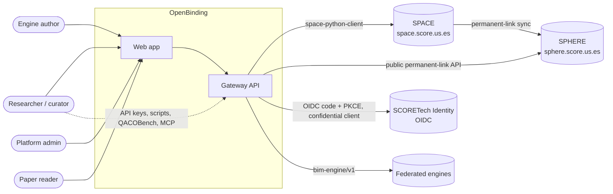
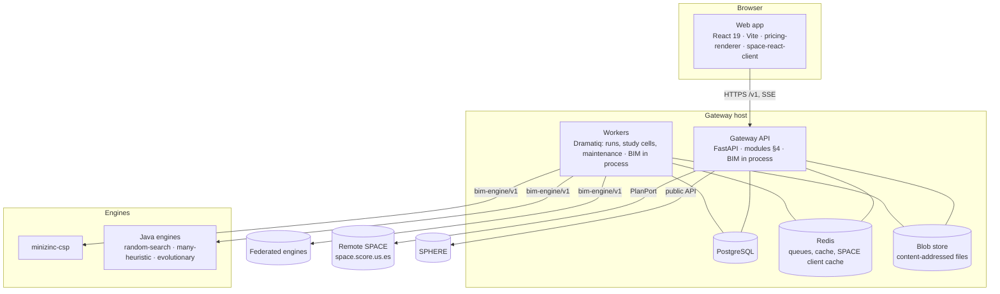
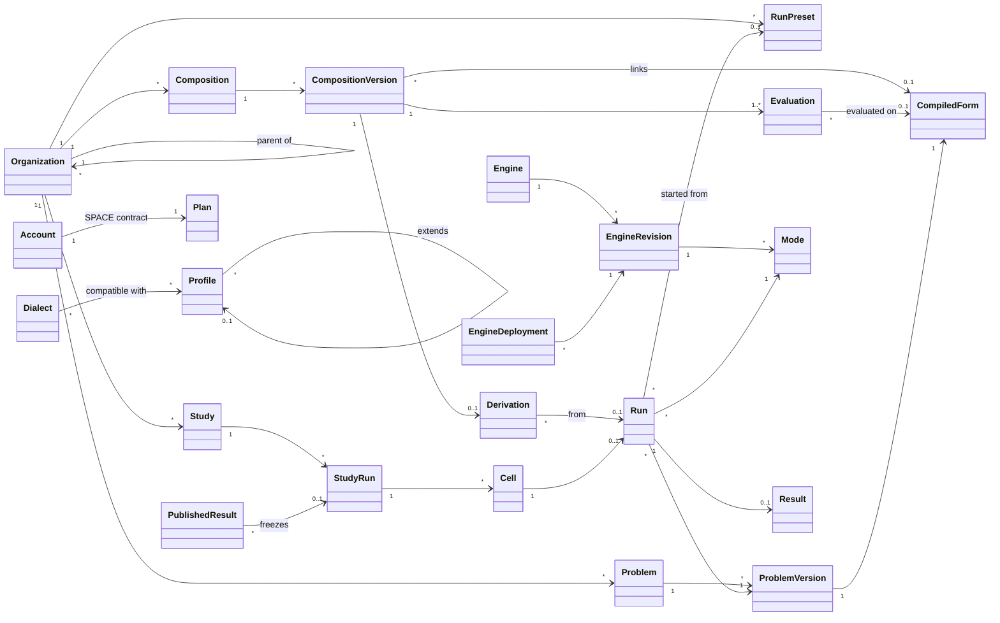
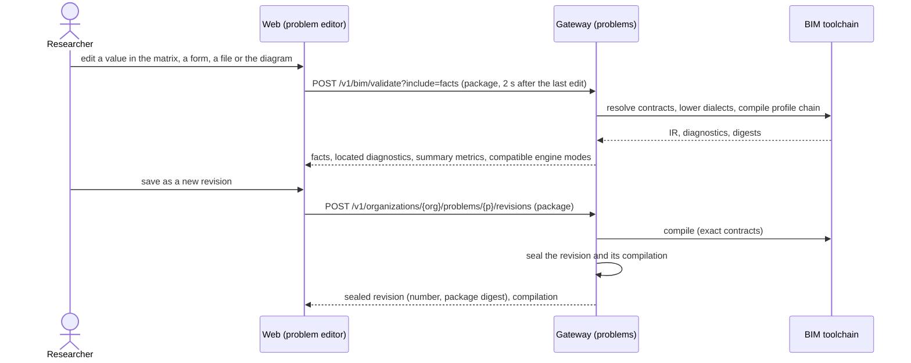
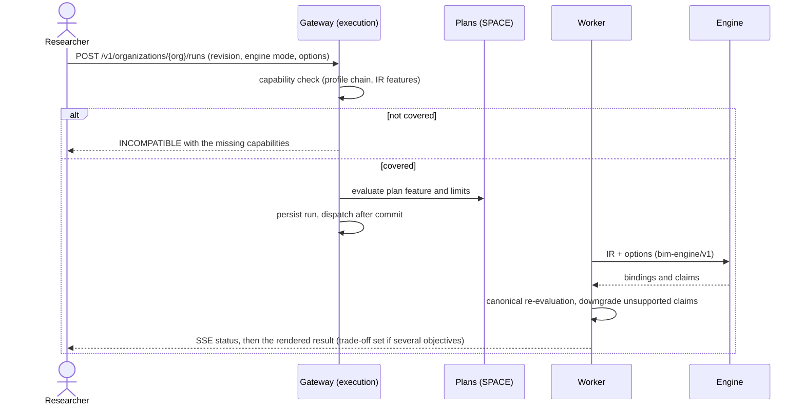
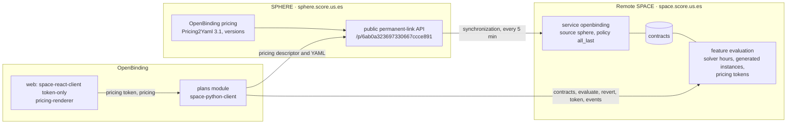

# OpenBinding architecture (target)

This document describes the architecture OpenBinding is moving to and the rules that get it there. The BIM
language is in [`BIM_V1.md`](BIM_V1.md) and [`BIM_CORE.md`](BIM_CORE.md).

Contents: 1 Principles · 2 System context · 3 Containers · 4 Backend · 5 Frontend · 6 Domain model · 7 Key flows ·
8 Language extensibility · 9 Plans (SPACE and SPHERE) · 10 Storage and retention · 11 Quality and gates ·
12 Stages and previews · 13 Repository layout · 14 Decisions

## 1. Principles that shape the architecture

1. **One canonical problem, many engines.** BIM packages compile to one canonical IR; engines receive only the IR,
   declare capabilities, and never decide the final numbers: the gateway re-evaluates every binding.
2. **Modular monolith, hexagonal inside.** One deployable gateway split into bounded-context modules; each module
   keeps its domain free of frameworks and reaches the outside world through ports.
3. **Everything external behind a port, everything shared behind a contract.** BIM toolchain, engines, SPACE,
   SPHERE, SCORETech Identity, blob storage and mail are adapters; contracts are versioned and tested on both sides.
4. **Render, never dump.** The frontend renders every domain object with a shared catalogue of components; source
   views are secondary.
5. **Immutable evidence, named for people and addressed by digest for machines.** Problem versions,
   compiled forms, runs, study runs and published results are sealed; permanent links and digests make them citable
   and verifiable. Screens name them by name, version number and date; a digest appears only where verifying is the
   task (§5.4).
6. **Small, reversible steps.** The target is reached by strangling the current code module by module, never by a
   rewrite.
7. **Small surface.** Every module, endpoint and screen serves a user journey; what none needs is
   retired before anything is moved or polished.
8. **One way to deploy.** Docker Compose runs every stage, production included.

## 2. System context



SPHERE and SPACE are separate services of the group. The OpenBinding pricing is written and versioned in SPHERE
at `sphere.score.us.es`, under the permanent link `https://sphere.score.us.es/p/6ab0a323697330667ccce891`, and
every stage reads it there through SPHERE's public API. SPACE follows that permanent link and operates
subscriptions. OpenBinding uses the remote SPACE at `https://space.score.us.es` in every stage; no SPACE runs
inside any stack (§9.4). OpenBinding never writes to SPHERE and never re-implements SPACE (§9).

## 3. Containers



| Container | Responsibility | Technology |
|---|---|---|
| Web app | every screen; renders, never dumps; gates UI features with the pricing token | React 19, Vite, TypeScript, Recharts, `pricing-renderer`, `space-react-client` |
| Gateway API | `/v1` HTTP API, authentication, authorization, all use cases | Python 3.11, FastAPI, SQLAlchemy async, Alembic |
| Workers | runs, study cells and their metrics, generation, retention and reconciliation jobs | Dramatiq over Redis |
| PostgreSQL | operational source of truth | PostgreSQL 16 |
| Redis | queues, leases, caches (including the SPACE client cache) | Redis 7 |
| Blob store | content-addressed bytes (packages, uploads, logs, exports) | filesystem volume; S3-compatible later |
| BIM toolchain | compile, evaluate and re-evaluate BIM, in process in the gateway, the workers and the seed (`bim_client.InProcessBim` behind `BimPort`); not a container of OpenBinding | wheels of a release of `javiercavlop/bim-toolchain` (private; to the SCORELabUS organization when public). Its `bim-service` (HTTP) is a separate deployable of that repository; the gateway has no setting to use it |
| Engines | solvers behind `bim-engine/v1`; built-in ones run beside the gateway, federated ones anywhere | Node/TypeScript (MiniZinc), Java |

Every container is a Docker Compose service (§12), except SPACE, which is remote (`space.score.us.es`). The lab only
has the one-shot `pricing-bootstrap`, a separate compose project that prepares the remote SPACE (§9.4).

## 4. Backend: a modular monolith

### 4.1 Modules (bounded contexts)

| Module | Owns | Main ports used | Code today (to move) |
|---|---|---|---|
| `identity` | accounts, browser sessions (`identity_sessions`), SCORETech Identity sign-in (the OIDC client, first-time provisioning, single-flight renewal, logout), RESEARCH by verified email, the bootstrap administrator by `sub`, orphan API keys ([IDENTITY.md](IDENTITY.md)); passwords (local mode) and API keys | `OidcClient`, `OneTimeStore`, `SessionLock`, `Mailer` | `modules/identity` (F5); `routes/auth.py` (local sign-in, which opens the same cookie session), `routes/users.py`, `security/*` |
| `collaboration` | organizations (nested, the only container), memberships, roles, invitations, audit, notifications | — | `collaboration.py`, `routes/organizations.py`, `repositories/organizations.py` |
| `problems` | problems of an organization, their sealed revisions (the uploaded `.bim.zip` and its digests) and compilations (one per revision and toolchain, insert-only), the stateless BIM services (`/v1/bim/validate`, `/v1/bim/templates`) | `BimPort`, `BlobStore` | `modules/problems` (domain, application, adapters; F0b); `integrations/bim*.py`, the engine protocol document in `services/engines.py` |
| `engines` | engine revisions, modes and manifests, federated deployments, conformance, capability matching | `EngineTransport` | `services/engines.py`, `services/engine_registry.py`, `services/probe.py`, `v1/remote.py` |
| `execution` | runs of an organization: submission, idempotency, dispatch, leases, cancellation, events, re-evaluation, results (with the trade-off set of a multi-objective run), neighbourhood; run presets (F1) | `EngineTransport`, `BimPort`, `PlanPort` | `modules/execution` (the run request and the runs API `/v1/organizations/{org}/runs`; F0b); `services/job_submission.py`, `services/execution.py`, `jobs/*`, `job_dispatch.py`, `worker.py` |
| `compositions` | compositions of an organization, their sealed versions (canonical Composition2Yaml bytes), their evaluations (one per toolchain, or one declared) and derivations, forks into another organization, composition environments with their adoption history, feed keys and feed, margins per offering plan (F4), the watches of the pricings its live versions read with their upstream events and the upstream watcher (F6), and the stateless language services (`/v1/compositions/validate`, `parse`, `serialise`, `diff`, `schema`). The language itself is the pure library `openbinding_gateway/composition` (contract `composition-library-pure`) | `BimPort`; `problems` and `execution` application APIs | `modules/compositions` (F1) |
| `laboratory` | studies of an organization (the editable matrix inline), study runs that freeze their definition and pin each revision's compilation, cells, protocol metrics, trade-offs across engines | `execution` application API | `studies.py`, `study_jobs.py`, `routes/studies.py` (`/v1/organizations/{org}/studies`; F0b); the generator moved to QACOForge; the decision-space workspace (`analysis_jobs.py`, analysis routes, analysis queue and worker) was removed by M9.6 |
| `publishing` | published results (a frozen study run), citations, Zenodo-ready export | application APIs of `problems` and `laboratory` | none: the reports, their publications and Explore were removed in F0a |
| `plans` | the SPACE port, the entitlement map, the pricing descriptor, plan changes and eligibility (RESEARCH by verified institutional email, or an administrator) | `PlanPort` (SPACE), `PricingSource` (SPHERE public API) | `modules/plans` (entitlement map, per-account quotas, the package copy of the pricing; F0b); `space_client/*`, `services/entitlements.py`, `access/policy.py`, `access/contracts.py`, `domain/entitlements.py`. Local metering and billing sponsorship were removed in F0b |
| `administration` | users, queues and engine health, storage and retention, audit, moderation of public content | application APIs of the other modules | `routes/admin.py`, `telemetry.py` |
| `shared` (kernel) | settings, logging, problem+json errors, pagination, digests, clock, ids, mail, content-addressed blobs | — | `modules/shared` (blobs; F0b), `core/*`, `mailer.py`, `security/bodylimit.py` |

### 4.2 Layout and dependency rules

```
openbinding-gateway/src/openbinding_gateway/
  app/                 composition root: create_app, lifespan, router registration, middleware, worker entry
  shared/              kernel (no imports from modules)
  modules/
    <module>/
      domain/          entities, value objects, policies; pure Python, no I/O
      application/     use cases, commands and queries, ports (typing.Protocol), public API (__init__.py)
      adapters/
        http/          FastAPI routers, Pydantic request/response schemas, problem mapping
        persistence/   SQLAlchemy models of the tables the module owns, repositories
        <external>/    space/, sphere/, bim/, engines/, cas/, blobstore/, adapters/
```

- Inside a module: `adapters → application → domain`. `domain` imports nothing from frameworks or adapters.
- Between modules: only through the other module's `application` public API, or through in-process domain events
  (audit, notifications, cache invalidation). No cross-module ORM joins; each table has one owning module.
- Modules form layers, and a module imports only modules below it: `administration` → `laboratory`
  → `compositions` → `execution` → `engines` | `problems` → `collaboration` → `identity` → `plans` → `shared`
  (`|` marks independent siblings). `compositions` sits above `execution` because a composition is derived
  from a run, and below `laboratory` because a study's trade-off set becomes compositions.
- External systems only through ports: `BimPort` (exists), `PlanPort`, `PricingSource`, `EngineTransport`,
  `BlobStore`, `IdentityProvider`, `Mailer`, `Clock`.
- Patterns: ports and adapters; application services as use-case functions; repositories with a unit of work per
  request (SQLAlchemy session); domain events for side effects; dispatch after commit (exists for runs); strategy
  for engine transports (built-in, federated).
- Enforcement: the empty packages `openbinding_gateway/app`, `shared` and `modules` exist, with import-linter
  contracts in `openbinding-gateway/importlinter-modules.ini`: `kernel` (`shared` imports no module, composition
  root or legacy layer), `composition-root` (modules and shared do not import `app`), `no-legacy-http` (modules
  do not import `routes` or `main`), `module-layers` (the order above, `exhaustive`), `module-inside`
  (`adapters → application → domain`) and `pure-domain` (no framework, client or adapter in `domain`). Run them
  from `openbinding-gateway` with
  `uv run --locked --extra test --group lint lint-imports --no-cache --config importlinter-modules.ini`.
  import-linter cannot express "other modules only through `application`" per module pair, so
  `openbinding-gateway/tests/test_modules_cross_import.py` (AST, in the gateway pytest suite) enforces it;
  `tests/test_modules_skeleton.py` checks the structure of the contract file and also runs `lint-imports` against
  planted violations (the teeth test); it is skipped where `lint-imports` is not installed (the CI `test` job syncs
  only `--extra test`); the CI `lab` job runs the contracts as a blocking step, with the `lint` group.
  The legacy `.importlinter` stays report-only and unchanged, next to the existing `tests/test_architecture_layers.py` ratchets.

### 4.3 Migration: strangler, one module at a time

0. Retire first. The decision-space workspace, the report editor, the library as a catalogue (organization
   library, project resources, project library), the composer and sponsorship lose their screens, then their
   endpoints, then their code, so nothing retired is ever moved. Done by M9.6 (2026-10-27): the owner skipped the
   `Deprecation`/`Sunset` period because nothing ran in production, and the 41 operations are removed. The data of
   the retired features was dropped with them, and the tables they left behind (reports, publications, collections,
   report evidence) went with the one-revision baseline of F0b. The versioned-artifact store itself, the read-only
   library and the project resources went in F0b too, once study runs froze their own definitions (D7), and so did
   projects and public read, once nothing pointed at a project: the organization is the only container (F0b B8).
1. Create `app/`, `shared/` and `modules/` with import-linter contracts; move nothing. Packages and contracts exist
   (§4.2); the blocking CI step is pending.
2. New capabilities land directly in modules: `plans` (M4) and the language registry (M5) are the first.
3. Move existing code one module per `refactor/<id>` change, behind characterization tests, keeping
   `docs/openapi.json` byte-identical. Order: plans → problems → engines → execution → laboratory → publishing →
   collaboration → identity → administration.
4. Each move deletes the old path, shrinks `ALLOWED_LEGACY`, `GATE_LIFECYCLE_LEGACY` and `MAX_LINES`, and ends
   with `routes/v1.py` and `main.py` reduced to composition.

## 5. Frontend

### 5.1 Layout and modules

The frontend is built as SPHERE's ([ADR 0053](adr/0053-frontend-on-sphere-stack.md)): its stack (Tailwind 4 with the
`tp` tokens, framer-motion, react-icons, react-helmet-async, bundled Monaco), its folders and its shell. Every screen
is one of SPHERE's pages, copied or adapted (each file names its origin; `THIRD_PARTY_NOTICES.md` lists them with
their reuse class), and SPHERE's frontend is the reference for any new one (`CONTRIBUTING.md`, "SPHERE first").

```
frontend/src/
  main.tsx                SPHERE's order: HelmetProvider > BrowserRouter > SkeletonThemeProvider > Suspense > App; the
                          brand palette is applied before the first paint
  App.tsx                 AuthProvider > SpaceProviderWrapper > OrganizationProvider > NotificationsProvider >
                          ToastProvider > DialogHost, Router
  routes/                 router.tsx: one useRoutes table under SPHERE's banners and the exported `screens` (one line per
                          screen, read by the screen budget and the end-to-end parsers); app-layout.tsx (the session's
                          chrome); route-outlet.tsx (each layout's error boundary and loading state); paths/ (address
                          builders)
  styles/tailwind.css     the one stylesheet: SPHERE's theme, both brand palettes, the layer order, the base rules
  content/                the about pages' data, the changelog and the Composition2Yaml examples
  modules/
    core/                 SPHERE's kit (components, hooks, utils, pages: dialogs with the focus trap, toasts, avatars,
                          skeletons, pagination, filters, the command palette, the 404, the card shell and the list view),
                          the transport and the generated types (api/: http.ts with the one apiClient and
                          fetchWithInterceptor, openapi.ts, types.ts, errors.ts with readApiError, refusals.ts, and the
                          account, BIM, health and problem types), editor/ (draft store, lint scheduler), diagnostics/,
                          theme/ (brand, editor themes), utils/ and the shared binding core in components/
                          (composition-renderer with its modes, workflow-graph, candidate-matrix, value-badge,
                          rules-and-objectives, provider-map, pricing-card, pricing-renderer, problems-panel, code-editor)
    auth/                 the session, sign-in pages, the account's client, the institution mark
    presentation/         SPHERE's layouts (authenticated and public), the landing and dashboard, the about pages,
                          /pricing, and the header's menus and palette (layouts/router/)
    organization/         OrganizationContext, /me/orgs, /organizations, /orgs/:org/:tab?, invitations
    composition/          the lists, the card page and its tabs, /compositions/new, /p/:id
    composition-editor/   /editor
    problem/              the organization's Problems tab and the problem page
    problem-editor/       /problem-editor
    run/                  the Runs tab, /runs/new, the run page, the run renderers, presets and derive
    study/                the Studies tab, /studies/new, the study page
    engine/               /engines, an engine's page, /me/engines and registration
    admin/                /admin/:section? and an account's page
    settings/, api-keys/, notification/, language/, beta/
```

Dependency rule, checked by `eslint-plugin-boundaries` at **error** (`boundariesLint.test.ts`): `modules/core` imports
no domain module, and a module imports another only through its `api/`, `types/`, `components/`, `hooks/` or
`contexts/`. Outside `modules/` there are only the application's root, the route table and the test kit.

New code uses the generated types; a drift between the gateway and the frontend fails `pnpm gen:api --check` in CI.

**One semantics.** BIM is the only problem language, and every number on screen comes from the gateway: values,
validity and violations from evaluations and `evaluate`, deltas from `neighborhood`, the size of the binding space
from the analysis, the Pareto front from study analytics. Eligibility, written candidate names and the workflow of a
problem come from the facts projection ([ADR 0048](adr/0048-problem-facts-projection.md)). The frontend formats,
groups by identical unit strings and compares identifiers; it never sums, ranks, digests or decides dominance.

**Deletion rule.** Nothing is in production: what a change replaces is deleted in that change, with no
compatibility shim, alias, redirect, re-export or deprecation. F2a deleted the Workbench's dead chart, digest and
diagnostics code, the client IR reader (`pages/Cases/bindingModel.ts`) and the client comparison words. F2b deleted
the Workbench shell (`pages/Workbench`, replaced by the BIM editor, now `modules/problem-editor`), the public Workbench's client reader of BIM
source files (`pages/Public/packageModel.ts`, its diagnostics wording and result panels), the BIM types of
`api/client.ts` and the client Pareto check and CSV export ([ADR 0051](adr/0051-problem-editor-on-the-shared-core.md),
[ADR 0052](adr/0052-study-front-export-and-presets-on-the-server.md)). F2c deleted the workspace under `/app` with its
pages, the public Workbench (`/problem-editor` validates for visitors), the API monolith (`api/client.ts`,
`api/platform.ts`), the legacy stylesheets and their cascade layer, lucide-react and CodeMirror.

### 5.2 Information architecture

SPHERE's information architecture is the reference (the owner's decision of 2026-11-16; it supersedes the plan's flat
header and its 33-screen budget).

- **Header** (SPHERE's): the `OPENBINDING` wordmark; **Tools** (Composition editor `/editor`, Problem editor
  `/problem-editor`, Composition2Yaml `/language`); **Explore** (Organizations `/organizations`, Compositions
  `/compositions`, Engines `/engines`); Pricing, Team, Research and Changelog; then **New** ▾ (composition, problem,
  run, study, organization, engine), the command palette (⌘K), the notification bell and the account menu (Inbox,
  Organizations, Compositions, Engines, API keys, Settings, Administration for administrators). There is no
  organization switcher: creation forms choose the organization (`?org=` preselects it).
- **`/`** is the landing to visitors and the dashboard to a session.
- **Organization:** `/orgs/:org/:tab?`, SPHERE's hero with tabs Overview · Compositions · Problems · Runs · Studies ·
  Members · Invitations · Hierarchy · Presets · Audit, each from the least role that may see it, and Connections (ADMIN,
  a beta tab as SPHERE marks them: only with Settings → Beta features on; the organization's SPHERE key). `/me/orgs`,
  `/organizations`, `/orgs/new` and `/orgs/join/:code` list, explore, create and join; `/me/orgs` shows the account's
  personal organization under Personal and the rest under Teams, as SPHERE does, and cards say Personal or Team. A
  personal organization's page offers its owner no Leave, Delete, Transfer, Add child or rename, and it is never
  dragged.
- **Resources of an organization** render outside its page, on the card shell, with the breadcrumb "Org / Name":
  `/compositions/:org/:composition/:tab?` (Overview · Analytics · Configuration · Versions · Operation · Settings; the
  version graph and diff in Versions; Operation is the members' tab of composition environments, the one opened in
  `?environment=<slug>`; `/p/:id` resolves a permanent link), `/problems/:org/:problem/:tab?` (Overview ·
  Candidates · Versions · Runs · Compositions · Source · Settings), `/runs/:org/:run` (Result · Settings · Provenance ·
  Timeline) and `/studies/:org/:study/:tab?` (Setup · Progress · Results · Front · Settings). Creation forms:
  `/compositions/new`, `/runs/new`, `/studies/new`, each with `?org=`.
- **SPHERE candidates** are a dialog, not a route: the six-step wizard (pricing, version, task and plans, mapping,
  preview, generate) opens from the problems tab's New ▾ "From SPHERE" (a new problem) and the problem page's New
  version ▾ "Add candidates from SPHERE" (and "Update from SPHERE" when an import pinned a recipe); its step and the
  pricing and version being added are in the address (`?sphereStep=&sphere=&sphereVersion=`), the rest of the form is
  kept for the session. It reads SPHERE only through the gateway (`…/sphere/pricings`, `…/sphere/expand`,
  `…/sphere/apply`).
- **Editors** are standalone pages open to visitors: `/editor` (Composition2Yaml, publish when signed in) and
  `/problem-editor` (BIM: a visitor edits, validates and downloads; saving needs an account). Each has Code and Visual,
  the Problems panel docked below and, below 640 px, its panes as tabs.
- **Engines:** `/engines` (the catalog), `/engines/:namespace/:name/:version`, and the account's `/me/engines`,
  `/me/engines/new` and `/me/engines/:name`.
- **Account and administration:** `/me/settings?section=`, `/me/api-keys`, `/notifications`, `/admin/:section?`
  and `/admin/users/:user`. Settings follows SPHERE's filtering by sign-in mode: in `scoretech` mode Account is
  SPHERE's IdentityAccountSection ("Open my SCORETech profile", a new tab that comes back to Settings) and the local
  email and password are not shown; Public profile (the display name and the avatar) is read-only there, with "Edit in
  SCORETech Identity", and editable in `local` mode through SPHERE's AvatarEditor restricted to Identity's shapes; the
  Danger Zone asks for a password only of an account that has one. People are drawn with SCORETech Identity's avatar
  renderer (`core/components/user-avatar`) wherever a `UserRef`, a member or the profile carries a descriptor: the header,
  member lists, the user search. The API keys page says when the keys stop working unless their owner signs in again,
  and the admin user's Identity tab names the account's issuer, subject, last renewal, live sessions and RESEARCH basis.
- **Sign-in:** `/authentication` is the way to SCORETech Identity in `scoretech` mode (no form; `?identity_error=` pages
  with Try again) and the local form, registration (`?view=register`), `/forgot-password` and `/reset-password` in
  `local` mode; `/sso/identity/callback` finishes a sign-in and `/sso/identity/username` chooses the username of a first
  one. The whole application waits for `GET /v1/auth/config`. The browser's credential is the HttpOnly session cookie
  (both modes): the gateway token lives in memory, is renewed from the cookie and names its session (`sid`), which the
  gateway checks on every request ([`IDENTITY.md`](IDENTITY.md)).
- **Missing and unreadable read the same:** anything missing, of another organization or not readable renders the
  in-place 404 (`e2e/not-found-parity.spec.ts` checks every kind of address with a 404 and a 403 answer).
- **Screen budget:** exactly **39** routed screens (`routes/screenBudget.test.ts`): 21 open to visitors and 18 behind
  an account. F5 replaced the old university sign-in's return page by `/sso/identity/callback` and added
  `/sso/identity/username`; F7 adds `/orbit` (40) and F9 five collection routes (45). Each user
  journey has a Playwright walk, mocked (`e2e/f2a-*.spec.ts`, `e2e/f2b-*.spec.ts`, `e2e/f3-*.spec.ts`) and live against
  the lab (`e2e/live/08-derive-seal-compare.spec.ts`, `09-public-fork.spec.ts`, `10-problem-editor.spec.ts`,
  `11-study-front.spec.ts`, and `12-sphere-candidates.spec.ts` against live SPHERE). F3 adds a dialog and a tab, no
  route. F4 adds the Operation tab and its dialogs (environment, adopt, feed key, instantiate a template), no route, so
  the budget stays 38; its walks are `e2e/f4-*.spec.ts` (mocked) and `e2e/live/13-operation.spec.ts` and
  `14-run-and-templates.spec.ts` (the lab, with its feed consumer and Mailpit). `e2e/live/visual-sweep.spec.ts` sweeps every screen of the route table in both palettes at 1440×900 and
  390×844, a 375 px pass and a dark operating system.

### 5.3 Rendering catalogue

The composition core ([ADR 0049](adr/0049-composition-renderer-core.md)): `modules/core/utils/composition/viewModel.ts` turns
gateway answers into a `CompositionViewModel`, and `CompositionRenderer` draws one **mode** of it. Each mode's
sections are a preset in `presets.ts`; a screen narrows them with `hideSections` and `density`.
Presentation hints live there and in per-viewer `localStorage` preferences, never in the document or on the
composition.

| Mode | Shows | Data | Used in |
|---|---|---|---|
| `catalog` | identity, value status, values, binding, offering, evidence, problem, the evaluation's findings (members) | the composition, the version with `include=document` | Overview |
| `architecture` | providers and the upstream SPHERE plans, each drawn from its stored snapshot (or the reference face) | the document, the facts of the evaluated compilation, `analytics`, `GET …/upstream` and the snapshots' YAML | Overview |
| `workflow` | the workflow with each task's candidate, the problem's candidates (members) | the document, the facts | Overview |
| `comparison` | the later workflow with what changed marked, and the candidates each version chose (drawn by the version diff, whose structured and file views are SPHERE's) | `GET …/diff`, both versions' content and documents | Versions (compare) |
| `calculator` | every one-task move with the gateway's comparison word and deltas | `GET …/neighborhood` | Configuration |
| `configurator` | another binding chosen per task and what the toolchain makes of it | `POST …/evaluate` | Configuration |
| `showcase` | what a visitor reads: what it does, value status, values, workflow, providers, plans, the problem's reference, and the offering's storefront from the version the evaluation read | the redacted public reads, `GET …/upstream` (public snapshots only) | Overview, for a visitor |
| `operations` | what an environment's feed serves: the version in effect (`CompositionInEffect`), the margin per plan of its pinned evaluation (`MarginTable`, mounted by the page), and the adoption history (a slot the page fills) | `GET …/environments/{environment}`, `GET …/versions/{version}/margins?evaluation=&users=`, `GET …/upstream`, `GET …/adoptions` | Operation (an environment's detail) |

The editor is a page, not a mode: `/editor` (`modules/composition-editor`: bundled Monaco with the gateway's lint and
completion from the problem, the visual pane, the Problems panel, the publish dialog) on the draft store.

| Component | Shows | Used in |
|---|---|---|
| `WorkflowGraph` | a Composition2Yaml workflow (seq, and, xor with probabilities, loop) as nested groups, each task with its candidate and status in words | problem Overview, composition Overview, both editors, version diff, showcase |
| `CandidateMatrix` | tasks × candidates × features from the facts, units in headers, the selected candidate marked, cards below 640 px; `select` mode for choosing, `edit` mode for the problem editor's cells | problem Candidates, composition Overview, both editors, configurator |
| `ValueBadge` | Verified · Declared · Unverified, always in words, and a value's origin: where the package writes it and, for an import, its source (Priced · Guarantee · Limit · Feature · Manual) with the upstream plan by name | every composition and problem screen |
| `ProblemsPanel` | located findings as buttons that jump to the place, counts announced, grouped by file for a BIM package | both editors, derive preview, catalog (read-only) |
| `RulesAndObjectives` | the rules (must or should), objectives and penalties of the facts, each rule with where the package writes it | problem Overview, problem editor (Rules) |
| `ProviderMap`, `PricingCard` | tasks grouped by provider; a plan drawn by pricing-renderer from its stored snapshot with the version's name and SPHERE's link, or its reference face | composition Overview, showcase |
| `PricingChangeReview` (core) | pricing-renderer's change review in the platform's palette: a subscription change (administration), or a provider's plan across two pricing versions, read only | admin user detail, Update from SPHERE, version comparison |
| version graph, change summary card | the versions and the fork lanes, and what changed between two versions on hover | Versions |
| analytics tab | structure and values per version over time, verified, declared and unverified apart, problem and compilation changes marked, a table for each chart | Analytics |
| `MetricCards` | a row of key numbers with units | dashboards, headers |
| `BindingTable`, `QoSAgainstBounds`, `ObjectiveBreakdown`, `EvaluationDiff`, `TradeOffChart`, `RunResult` | the run result: binding, QoS against bounds, objective terms, claimed against evaluated values, the trade-off set | run page, study cell |
| `CompositionInEffect` (core) | the version in effect in an environment: its adoption, value badge, the candidate per task with the upstream plan it was read from, the offering version its evaluation read; a slot for F6's upstream badge | Operation |
| `MarginTable` (core) | the margin per offering plan as the gateway computed it: amounts as the gateway's strings rounded by their text, a loss in words as well as tone, every status worded; a users field that only asks again | Operation, Configuration (the calculator's demand) |
| environment card, Operation tab, adopt dialog, adoption history, feed key panel, check panel | SPHERE's collections frame and collection card, the versions tab's rows and the API keys page's reveal-once block applied to environments: the version in effect per environment, adoption with the environment's `If-Match`, the history newest first, the feed's address and its `obe_` keys shown once, "Check now" in one sentence per source | Operation, Versions (Adopt…), run page and derive dialog (Adopt in environment) |
| template card, instantiate dialog | the composition templates of the catalog and starting one (its problem and a sealed first version) | New composition |
| `VerdictBadge` | OPTIMAL · FEASIBLE · UNSAT · TIMEOUT · INCOMPATIBLE | everywhere a run appears |
| `BindingSpaceBadge` | the size of the binding space the analysis gives | problem pages, study analytics |
| code editor | bundled Monaco (YAML, JSON, XML) with located diagnostics as markers and completion | both editors |
| `LogPanel` | collapsed, searchable, downloadable log | run result, admin errors |
| `SourceView` | read-only code viewer with copy and download | Source tabs, examples, previews |

Charts use Recharts. A hygiene test forbids rendering `JSON.stringify` output or `<pre>` outside `SourceView` and
`LogPanel`, and digest-shaped text outside the components that §5.4 allows. Every new component is usable on a phone
(390 px) and by keyboard and screen reader; the live visual QA (`e2e/live/visual-qa.spec.ts`) measures overflow,
clipping, touch targets and errors on every screen at both sizes.

### 5.4 Identifiers on screen

People read names, machines read digests.

| Thing | Shown as | Not shown |
|---|---|---|
| Problem version | `checkout-flow` v3 · sealed 20 Aug 2026 | content or version digests |
| Run | run 14 of `checkout-flow` v3 · `minizinc-csp` 1.1.1 exact · 21 Oct 2026 | job UUID, request digest |
| Study run | `engines-vs-suite` run 3 · 21 Oct 2026 | matrix or cell fingerprints |
| Published result | its title · published 22 Oct 2026 | edition fingerprint |
| Engine | `minizinc-csp` 1.1.1 · mode exact | manifest digest |

The API keeps every digest. Export manifests are the only places that show one, as a single value with a copy
button; `SourceView` shows files as they are. UUIDs never appear in UI text; URLs
use permanent ids or slugs. The hygiene test fails on a digest-shaped string (`sha256-` or 40/64 hexadecimal
characters) or a UUID rendered anywhere else.

## 6. Domain model



Mapping to `v1` names: Problem = `BindingCase` (owned by an organization), ProblemVersion = `BindingCaseRevision` (the
uploaded package and its digests), CompiledForm = `ProblemCompilation` (its IR, per toolchain), Run = `Job` (it names a
revision and its compilation and never copies the IR), Result = job result plus re-evaluation, PublishedResult = not built
yet (F1/F9; the old `publications` table is retired). A problem version is its uploaded package, addressed by digest; there is no
component catalogue. A study run freezes its definition, with the compilation of each revision it runs. Every sealed entity has a content digest
that the API returns and Verify checks;
screens name it as §5.4 says. Permanent links address problems and published results independently of
slugs.

**As built after F0b.** The organization is the only container; the schema has 25 tables. An organization owns its
problems (`binding_cases`), their revisions (`binding_case_revisions`: the uploaded package, held by a `blobs` row of
that organization, with its digests) and their compilations (`problem_compilations`: the IR of a revision by one
toolchain, insert-only and unique by `(revision_id, compiler_digest)` and by `(revision_id, compilation_digest)`;
since F1 each row also stores the `semantic_digest` of its IR, which two toolchains that read the problem alike share). A run
(`jobs`, its creator in `created_by_id` like every other table) belongs to the organization and names a revision and a compilation through a composite foreign key, so it cannot
run another revision's IR. A study (`studies`) holds the editable definition; a study run (`study_runs`) holds the frozen
copy and its digest, and each cell (`study_cells`) pins the compilation it runs. There are no projects, no artifact store,
no snapshots and no public read. Sealed rows reject UPDATE through triggers declared once in `db/triggers.py`
(`immutable`, `protect`, `retain`); history is kept by `RESTRICT` foreign keys rather than by refusing every DELETE, so
a problem nobody ran can be deleted ([ADR 0023](adr/0023-trigger-ddl-single-source.md),
[ADR 0024](adr/0024-immutable-means-no-update.md)).

**As built after F1.** The schema has 30 tables. Five arrived with compositions and presets, and one column with the
problem link:

| Table or column | What it holds | Mutability and deletion |
|---|---|---|
| `problem_compilations.semantic_digest` | the digest of what the IR means, shared by toolchain releases that read the problem alike ([ADR 0042](adr/0042-problem-link-semantic-digest.md)) | insert-only with its row |
| `compositions` | a composition of an organization: slug, name, description, `kind`, `archived` | mutable (ETag `updated_at`); deleted by `deleteComposition` or with its organization |
| `composition_versions` | the canonical Composition2Yaml bytes of a version (inline `TEXT`, at most 256 KiB), its ordinal and label, `syntax_version`, `values_status`, content digest, the linked revision and compilation, the evidence run, the offering source, `based_on`, `forked_from` and `analytics` ([ADR 0045](adr/0045-composition-versions-canonical-bytes.md)) | insert-only (`immutable`); deleted with its composition |
| `composition_evaluations` | one evaluation per version and basis (a toolchain's `compilerDigest`, or `declared`): outcome, values with units, violations, digests, toolchain and diagnostics located in the stored bytes ([ADR 0044](adr/0044-one-evaluation-per-version-and-toolchain.md)) | insert-only; deleted with its version |
| `composition_derivations` | the edge a derived version keeps: source (`run` or `binding`), revision, compilation, binding and its digest, run and point, provenance | insert-only; deleted with its version |
| `run_presets` | an organization's named run settings: engine, registration, mode, options, optimisation | mutable (ETag); deleted by `deleteRunPreset` or with its organization |

**As built after F4-A.** Three tables arrived with composition environments
([ADR 0054](adr/0054-composition-environments-and-the-feed.md)):

| Table | What it holds | Mutability and deletion |
|---|---|---|
| `composition_environments` | an environment of a composition: slug (its feed's address), name, description, operator, `adopt_role`, `expected_users`, the version in effect and the adoption ordinal; composite keys keep it within its composition's organization and its version within its composition | mutable (ETag `updated_at`), but organization, composition, slug and creation are `protect`ed; the version in effect changes only on adopt; deleted by `deleteCompositionEnvironment` or with its organization |
| `composition_adoptions` | each adoption, numbered per environment: the version, the previous one, the pinned evaluation (composite key into its version) and the version's content digest (the feed's ETag after it), the actor and a note | insert-only (`immutable`, no UPDATE); deleted only with its environment or organization |
| `composition_environment_keys` | an environment's feed keys (`obe_…`): prefix, SHA-256 of the key, label, creator, last use, revocation | secret, prefix, owner and creation `protect`ed; a revoked key stays revoked; deleted with its environment |

A composition with environments is not deleted (`409 composition_in_operation`).

**As built after F5-D.** `organizations.personal_owner_id` marks an account's personal organization (SPHERE's
`isPersonal`): unique, `RESTRICT` on `users`, and a CHECK that keeps it a root. Every account gets one in the
transaction that creates it, and account deletion deletes it with everything it holds, runs included (the one
exception to runs being history)
([ACCOUNTS_AND_PLANS.md](ACCOUNTS_AND_PLANS.md), [ADR 0056](adr/0056-identity-bff-session.md) addendum).

**As built after F6-A.** Four tables keep what live versions read upstream
([ADR 0057](adr/0057-upstream-watches-and-events.md)):

| Table | What it holds | Mutability and deletion |
|---|---|---|
| `pricing_watches` | one watched source per read scope (`public`, a registry, or an organization for keyed reads and URL offerings): the manifest's ETag, the whole version order, the latest version and its snapshot, status, schedule, back-off, lease and the `gone` debounce | watcher state, mutable; key, source and scope `protect`ed; an organization-scoped watch is deleted with its organization, a shared one stays |
| `pricing_watch_refs` | what a sealed version reads: version × watch × subject (`binding`, `offering`) × pinned version, with the tasks, the selection and the pinned snapshot; unresolved rows name the family without a watch | insert-only (`immutable`); deleted with its composition or organization |
| `pricing_ref_attempts` | the back-off of an organization's unresolved `from` entries (failures, last error, next attempt) | mutable; deleted once resolved, or with its organization |
| `composition_upstream_events` | one classified change per (version, watch, old → new) for bindings and per (composition, watch, new) for the offering: category, reasons, the bounded diff, both snapshots, `notify`, state, note and stamps | written once (`ON CONFLICT DO NOTHING` on partial unique keys); only state (`open` → `reviewed` → `resolved`, a `state_machine` trigger), the note and the stamps change; deleted with its composition or organization |

Versions, evaluations and derivations name problem compilations (and runs) through `RESTRICT` foreign keys, so a
problem a composition links answers `409 problem_has_compositions` on delete, and the admin purge keeps the terminal
runs a version or derivation names. Deleting an organization locks its compositions before its problems and deletes
them with the subtree.

## 7. Key flows

### 7.1 Author, validate and version a problem



### 7.2 Run a problem



A run never copies the IR. `createRun` resolves the revision's compilation by compile-or-get: it is looked up by
`(revision, compilerDigest)` and compiled and stored only on a miss, once per revision and toolchain
([ADR 0027](adr/0027-compile-or-get.md)). The run records the compilation's id and IR digest; the worker loads the IR
from `problem_compilations` when it claims the job and refuses to run one whose digest differs
([ADR 0026](adr/0026-engine-ir-from-problem-compilations.md)). Re-evaluation, the neighbourhood and the IR view read the
same row, and a study run pins one compilation per revision for all its cells
([ADR 0028](adr/0028-frozen-study-definitions.md)).

### 7.3 Compose: seal, derive and evaluate a composition

```mermaid
sequenceDiagram
  actor U as Researcher
  participant G as Gateway (compositions)
  participant P as problems / execution
  participant B as BIM toolchain (BimPort)
  U->>G: POST …/compositions/{c}/versions (Composition2Yaml) or …/derive (run or binding)
  G->>G: read the document (language slot): syntax, sections, coherence, schema
  G->>P: resolve problem.ref and compilation; compile-or-get on the installed toolchain
  G->>G: semantic-digest gate; judge workflow, candidates and units against the IR's facts
  G->>B: evaluate(installed IR, binding) (evaluation slot)
  B-->>G: values, violations, or binding_invalid
  G->>P: check the evidence run's solution
  G->>G: one short transaction: lock, dedupe by content digest, insert version, evaluation, derivation
  G-->>U: version (verified or declared), evaluation, diagnostics
```

Every path that judges a composition (seal, check, derive, fork, re-evaluate, evaluate, neighbourhood) goes through
one assessment (`modules/compositions/application/assess.py`). It writes nothing; sealing then stores its result in
one short transaction. A document with a `problem` is evaluated on the installed toolchain's compilation of the linked
revision: the link holds while the semantic digests agree (an info when the named compilation is another release's),
and is refused when they differ ([ADR 0042](adr/0042-problem-link-semantic-digest.md)). Values and validity are
`BimPort.evaluate`'s, exactly as returned ([ADR 0043](adr/0043-values-only-from-bimport.md)). A document without a
problem is stored with its values declared. The language is specified in [COMPOSITION2YAML.md](COMPOSITION2YAML.md).

On the web (F2a) the same path is walked in at most five screens: the problem page (workflow and candidates from
the facts) → a run → "Derive composition" (a preview with `seal: false`, then the seal of the same request; a new
composition is created when the preview is asked for, so an abandoned derivation leaves it empty) → the Editor,
whose visual form rebinds a task and whose live check (`…/versions/check`) states the values before the next seal →
Versions, comparing the two entry by entry and line by line. A public composition is read at its showcase and
forked from there into another organization ([ADR 0047](adr/0047-public-compositions.md)).

#### Composition environments (F4-A)

A composition **environment** is where an application reads the version of a composition in effect. A person adopts a
sealed version in it (`POST …/environments/{environment}/adopt`, with the environment's ETag in `If-Match`); the
adoption pins the evaluation the version was judged on, and the environment's **feed**
(`GET …/environments/{environment}/composition`) serves that version's sealed bytes with its content digest as a
strong ETag, so it moves only on adopt. An application reads it with an environment-owned feed key (`obe_…`),
which opens nothing else ([ADR 0054](adr/0054-composition-environments-and-the-feed.md)). The feed's answers, in
order:

| # | Condition | Answer |
|---|---|---|
| 1 | no credential | 401 `unauthorized` |
| 2 | a malformed, unknown or revoked credential, or an inactive member | 401 `unauthorized` |
| 2b | a member's personal key without `compositions:read`, or whose boundary excludes the feed | 403 |
| 3 | the credential's feed budget spent (`FEED_RATE_PER_MINUTE`) | 429 `feed_rate_limited`, `Retry-After` |
| 4 | a feed key whose environment is not the path's | 404 `not_found` |
| 5–6 | a member credential: the composition's 404 parity, or a missing environment | 404 `not_found` |
| 7 | nothing adopted yet | 404 `nothing_adopted` |
| 8 | `If-None-Match` names the current ETag, or `*` | 304 |
| 9 | otherwise | 200, the adopted version's bytes, `application/yaml` |

Margins per offering plan (`GET …/versions/{version}/margins`, and `users` on `evaluate`) are computed once, on the
gateway, from a stored evaluation and the offering snapshot it read ([ADR 0055](adr/0055-margins-per-offering-plan.md)).
`check` reports the version in effect against what its sources publish now and writes nothing.

#### Upstream watches and events (F6-A)

Every sealed version records what it reads upstream: `seal_into` inserts its **watch references**
(`pricing_watch_refs`, insert-only) to the **watches** (`pricing_watches`, one per source and read scope) of its `from`
entries, the value origins of its linked revision and its offering, from stored data only; a `from` without a stored
snapshot is an unresolved ref, resolved later on its own back-off (`pricing_ref_attempts`). The **upstream watcher**
(`modules/compositions/application/upstream_watcher.py`) is a second task of the gateway lifespan beside the job
reconciler: every replica starts it, one works per cycle (its own advisory lock), and it claims due watches that a
**live** version (a composition's latest, or an adopted one) references, asks each manifest conditionally, snapshots a
new latest version as a system read, classifies it against each live version with the pure classifier
(`upstream_classify`) and records an **upstream event** (`composition_upstream_events`), telling the members who can
act. Events change only their state (`open` → `reviewed` → `resolved`), the review note and the stamps; a person's
seal resolves them (`resolve_on_seal`, inside `seal_into`), never a route. Badges are computed when read, so nothing
the watcher does moves an environment's ETag or a feed ([ADR 0057](adr/0057-upstream-watches-and-events.md)).

| Setting | Default | What it does |
|---|---|---|
| `UPSTREAM_WATCH_ENABLED` | `true` | polls watched pricings (with `SPHERE_ENABLED` off nothing of the default SPHERE is read) |
| `UPSTREAM_POLL_INTERVAL_S` | `300` | how often a watch is asked, staggered per watch; at least 60 in production, 10 elsewhere (the lab: 20) |
| `UPSTREAM_POLL_BATCH` | `50` | watches claimed per cycle |
| `UPSTREAM_READS_PER_CYCLE` | `20` | SPHERE requests a cycle may send (manifests, YAML, family reads) |
| `UPSTREAM_CLASSIFY_PER_CYCLE` | `100` | classifier calls per cycle |
| `UPSTREAM_NOT_FOUND_CONFIRMATIONS` | `2` | 404s, from requests actually sent at least one interval apart, before a family is gone |
| `UPSTREAM_FAILURE_BACKOFF_MAX_S` | `3600` | the longest a failing watch waits |
| `UPSTREAM_RESOLVE_PER_CYCLE` | `2` | attempts at unresolved refs per cycle |
| `UPSTREAM_RESOLVE_BACKOFF_MAX_S` | `21600` | the longest an unresolved ref waits |
| `PROPOSAL_EXECUTION_DEADLINE_S` | `600` | how long a proposal may run without progress before housekeeping closes it (F6-B) |

`/v1/admin/queues` carries an `upstreamWatch` block (watches by status, what is due, the last observation, the
events of the last day by category); `/health/ready` ignores the watcher, so a slow SPHERE never takes a gateway out of
rotation.

### 7.4 Study

A study selects problem versions, engine modes, parameter sets and seeds. A study run expands the
matrix into cells, each one a run with frozen inputs; cells retry independently. Analytics read only re-evaluated
results and compute the QACOBench protocol metrics: coverage (processable over submitted), conditional binding
yield (binding-returning over processable), gap to the certified optimum, verdict reconciliation (an UNSAT proof
contradicted by a validated binding, or an OPTIMAL beaten, invalidates the run), runtime distributions and rankings.
With several objectives, the results view also shows, per problem, the trade-off set across engines. The QACOBench
harness keeps working against the public API; the study is the same protocol inside the platform.

### 7.5 Publish a result

`Publish` freezes a finished study run. The gateway seals the exact problem versions, engine
revisions, budgets, seeds and computed metrics into a published result with a permanent link, a digest and a
citation, and offers a Zenodo-ready export (results as CSV and JSON plus a manifest with every digest). A published
result is never edited: a correction is a new published result that names the one it corrects, and withdrawal hides
it from Explore while its permanent link keeps answering (§10). There is no document editor; the text of a paper lives
in the paper.

### 7.6 Plans

See §9.

## 8. Language extensibility

### 8.1 Layers

| Layer | Owns | Changes how |
|---|---|---|
| BIM core | envelope, `Instance`, role-indexed resources, references, digests, provenance | BIM MAJOR/MINOR release only |
| Profile | a problem family: roles and cardinalities, resource types per role, output IR schema, capability vocabulary, limit vocabulary, evaluation semantics, adapter; **may extend one other profile** | new profile version |
| Dialect | a concrete syntax for resources of one or more profiles (media type, schema or XML root), lowered to the profile's canonical resource types or to declared extension points | new dialect version |
| Adapter | the lowering (and, for profiles, compile hooks and evaluator plug-ins) | new BIM release (§8.3) |

### 8.2 Profiles that extend profiles

A profile may declare `extends: {namespace, name, version, digest}` (single inheritance). The child inherits the
parent's roles, cardinalities, resource types, vocabularies and output schema, and may:

- add roles and resource types, and tighten (never loosen) cardinalities;
- add capability dimensions and values, and limit names;
- extend the output IR with new sections described by a schema delta, without changing the meaning of any parent
  field;
- add evaluation semantics (constraints, aggregation operators, objective terms) implemented in the canonical
  evaluator, so the gateway can re-evaluate every binding;
- add compile hooks: deterministic pre-solve transforms from extension resources to features or constraints.

Compilation resolves the chain from the root, validates roles and cardinalities against the merged contract, lowers
dialects, runs the parent's lowering, then each child's lowering and hooks, validates the merged output schema and
records the whole chain, every adapter digest and the compiler digest in the IR.

**Placement becomes the reference extension.** `qos-binding-placement/v1` is re-declared as a profile extending
`qos-binding/v1`. It adds the `Placement` resource type in the `candidateCatalog` role (pools, capacities, network
latencies, events, transitions, global latency: the `R` and `L` of the CLASP model), its capability dimension and
evaluator semantics. Its output keeps today's `BindingProblem.spec.placement` shape, so engines, goldens and digests
of existing placement problems do not change; only the declaration moves from the core profile into the extension.
A pricing-aware profile (candidates as subscriptions; iPricings plus expected consumption compiled to cost features,
as in CLASP and PACO) is the next candidate. A domain that fits the core without new semantics — quantum resource
selection — needs no extension at all: it is plain BIM data.

### 8.3 Adapters

Every adapter is built in: reviewed Python in `bim-toolchain` (qos-binding, placement, BPMN), shipped with a BIM
release and guarded by code review, goldens and consumer contracts. The gateway keeps no registry of dialects or
resources and takes no submissions: what it compiles is what the installed `bim-toolchain` release ships.

### 8.4 Language API

| Operation | Purpose |
|---|---|
| `GET /v1/language` | overview: BIM core version, compiler digest, installed profiles and dialects, counts |
| `GET /v1/language/profiles`, `.../profiles/{namespace}/{name}`, `.../versions/{version}` | profiles with their chain, roles, capabilities, schemas and supporting engines |
| `GET /v1/language/dialects` (same shape) | dialects |
| `GET /v1/language/schemas/{kind}` | schemas (download) |
| `POST /v1/language/compile` | compile a package or an exact problem version: diagnostics, summary metrics, compatible engine modes |

Today the gateway serves `GET /v1/engines/protocol` (the installed Profiles with the engine protocol digest, read by
the engine registration form), `GET /v1/bim/templates` and `POST /v1/bim/validate` (the problem editor checks there
live and saves through the problems API, `POST /v1/organizations/{org}/problems` and `…/revisions`; a visitor's
`/problem-editor` validates there too, and saves nothing). `GET /v1/profiles`,
`GET /v1/dialects`, `/v1/examples`, `/v1/validate`, `/v1/instances` and `/v1/snapshots` were removed in F0b, with
no deprecation period. The registry routes (`POST /v1/dialects`, `/v1/resources`, their
approvals), `/v1/schemas/{kind}`, `/v1/catalog` and the deprecated pricing YAML proxy `GET /v1/pricing` were removed in
F0a.

### 8.5 Developer kit

`bim-toolchain` ships a `bim-ext` command: `new` (scaffold a dialect or profile), `test` (schemas, golden examples,
double lowering) and `pack` (extension package and digest), plus a template repository and a how-to in `docs/`. A
dialect reaches the gateway in a `bim-toolchain` release, never through an upload.

## 9. Plans: SPACE and SPHERE

### 9.1 Topology



| Who | Responsibility |
|---|---|
| SPHERE (`sphere.score.us.es`) | authoring and versioning of the OpenBinding pricing; public permanent-link API |
| SPACE | contracts, feature evaluation, the solver-hours and generated-instances usage levels, contract migration when the pricing changes, events |
| OpenBinding | enforcement points and its own counts for the other limits, contract creation (registration, a first SCORETech sign-in), plan changes for FREE and RESEARCH and by administrators, pricing display, token issuance to the browser |

| Stage | SPHERE | SPACE |
|---|---|---|
| Unit tests and CI | a recorded copy of the pricing in `tests/fixtures`; no network | a fake `PlanPort` or `OpenGate` |
| Lab, develop preview | `sphere.score.us.es`, read only | `space.score.us.es` |
| Production | `sphere.score.us.es` | `space.score.us.es` |

### 9.2 Gateway side

- `modules/plans` implements `PlanPort` with `space-python-client` 1.x (asynchronous transport, Redis cache provider)
  and a MANAGEMENT-scoped key; `OpenGate` remains for development and tests and is refused with `APP_ENV=prod`.
- The **entitlement map** (operation → SPACE feature id `openbinding-<name>` and limits) lives in
  `modules/plans/domain/entitlement_map.py`, the only place the ids are spelled. **Delivered (F0b):** at start-up
  (`main.check_pricing`) the gateway reads the published pricing (from SPACE, or a package-data byte copy under the
  open gate), refuses to start when a feature or limit it references is missing or not `NUMERIC`, and, with SPACE
  enabled, requires `SPACE_ORGANIZATION_ID` and the `pricing-token-jwks` capability (fatal under `APP_ENV=prod`, a
  warning elsewhere). Pricing tokens are verified against SPACE's JWKS and matched to the account with
  `pricing_token_user_id`; there is no unverified fallback. The same check on `pricing_activated` moves to F8, with the SPACE ledger.
- Quotas are per account (`modules/plans/domain/quotas.py`); organizations carry no billing sponsor.
- Pricing 0.2.0 (`docs/pricing/`) declares seven features and twelve limits. SPACE tracks two usage levels, both
  renewable and monthly: `solverHours` and `generatedInstances`. A run on a built-in engine, a study cell or the
  solver part of a solver-aware generation is admitted while the month's hours are not exhausted and then consumes
  its time budget; a run that stops early is not refunded, so the count can be checked against the budgets. A
  generation is admitted while the month's instances are not exhausted and consumes the instances it writes. The
  other limits are plan values that the gateway compares with its own counts (running runs, cells of a study run, a
  run's budget, instances per generation request, problems and collections owned, repository storage, federated
  engines, API keys), so no counter can drift. The repository limits apply to FREE only; the
  other plans declare them as `.inf`.
- Gated operations call `evaluate(user, feature, expected_consumption)`; an operation that fails after consuming
  calls `revert_evaluation` (SPACE honours it within two minutes).
- SPACE events (`synchronized`, `pricing_created`, `pricing_activated`, `pricing_archived`, `service_disabled`)
  invalidate caches and are relayed to browsers as a `plans.changed` notification.
- **The `PricingSource` port (F3).** Every read of SPHERE, of an operator's `SPHERE_REGISTRIES` and of a
  user-supplied Pricing2Yaml URL goes through one port, `modules/plans/application/pricing_source.py`, installed by
  `main._lifespan` (`SphereHttpSource` for the default SPHERE and each registry, `UrlSource` for URLs). Its requests
  go through `core/outbound.py`, the one outbound policy the remote engine client shares: https only, every DNS
  answer checked and pinned (global addresses, except an operator's registry), no redirects for SPHERE and at most
  `OFFERING_URL_MAX_REDIRECTS` revalidated ones for a URL, identity encoding, `SPHERE_MAX_BYTES` (5 MiB) and
  `SPHERE_TIMEOUT_S`. SPHERE ids are checked (24 hexadecimal characters) before a URL is built. Only anonymous answers
  are cached, for `SPHERE_CACHE_TTL_S` and then revalidated by `ETag` (SPHERE serves no `Last-Modified`); a keyed
  answer is never cached. Back-off follows SPHERE's own keying (per organization key, per registry, anonymous): a
  429 closes that bucket only, `RateLimit-Remaining` at its 10 % reserve closes it until `RateLimit-Reset`, a 404 or
  503 is a 60 s negative entry for that path, and transport failures back the host off. A version's bytes must match
  its `ETag`; the manifest's `contentHash` is SPHERE's *functional* hash (`content_hash.py`, js-yaml reading, sorted
  keys, `saasName` dropped), and a mismatch is logged and reported, never a refusal. Pricings are read **before** a
  compile or evaluation slot and outside any transaction, never during compilation or evaluation; the YAML loader
  (`yaml12.py`, alias, depth and node limits), the hash and the normaliser (`pricing2yaml/`) run in a worker thread.
  The tests read SPHERE from recordings (`tests/fixtures/sphere`, `tools/record_sphere_fixtures.py`) and cannot open
  a network socket (`OPENBINDING_FORBID_NETWORK=1` in the CI unit shards).
- **Organization connections (F3).** An organization ADMIN connects the organization to SPHERE with an API key
  (`org_connections`, `PUT /v1/organizations/{org}/connections/sphere`). The key is checked with SPHERE's
  `/users/me`, encrypted with the gateway's Fernet keys (`security/secrets.CredentialStore`, the store that
  already holds engine credentials: one key store and one rotation, rather than a second AES-256-GCM cipher),
  decrypted only for one call and never returned or logged; of `/users/me` only the user id, username, the key's
  scopes and expiry are kept. SPHERE decides what a key reads: a MANAGEMENT or ALL key of an organization ADMIN or
  OWNER reads every private version of that organization, a VIEW key a private pricing only with an explicit grant.
  The key is sent only to the default SPHERE, never to a registry or a URL; a 401 marks the connection invalid and
  the read is retried anonymously. "Connect SPHERE" by OAuth cannot read a version's YAML and waits for F8.
- **Problems from SPHERE (F3).** `modules/problems` turns pricings into ordinary BIM candidates: a validated import
  recipe (`problems/domain/sphere/recipe.py`, stored pinned in the generated revision's provenance), a deterministic
  generator (`problems/application/sphere/generate.py`, in `application` because it reads `plans`' normaliser, which
  no `modules.*.domain` may import), `sphere/expand` and `sphere/apply` (apply stores exactly what the preview showed,
  its base checked under the problem lock) and `problem_value_origins`, one immutable row per generated value. Demand
  and requirements are compile-time `requires.predicate`s: eligibility stays the compiler's. Every generated package
  in the repository is a JSON file map, so the BIM corpus does not move. `docs/SPHERE.md` is the reference.
- **Provenance and the offering (F3).** Derive writes a generated candidate's `from` from the revision's value origins,
  and the assessment refuses a `from` that misstates it (`c2y_provenance_mismatch`). A composition's offering is read
  through the port when an evaluation row is created (never on `versions/check`) and its version is stored on the
  evaluation; `GET …/compositions/{composition}/upstream` answers upstream plans, value sources and the offering from
  stored snapshots alone.
- `GET /v1/plans/pricing` (public, F3) serves OpenBinding's own pricing through the `PricingSource` port: the family
  `SPHERE_OPENBINDING_PRICING_ID`, the version labelled `SPACE_PRICING_VERSION` in its manifest (so a new release
  is a setting), snapshotted once and verified like every SPHERE read; the answer carries the label, the version
  id, the permanent link, the YAML (for pricing-renderer) and the parsed document (`.inf` as `null`), with an
  `ETag` and `public, max-age=300`. When SPHERE cannot be read, a stored snapshot of that label is served; with
  none, `503 pricing_unavailable`. It needs no SPHERE key.
- Removed: the legacy SPHERE client and pricing catalog modules, the keyed `/v1/pricing` proxy (its `current` and
  `catalog` routes) with its key permission, and OpenBinding's own SPHERE key and organization settings (F3); admin
  pricing validation, `space_client/deployments.py`, the release sweeps, local
  metering (`domain/usage_counters.py`) and the sponsorship capacity checks.

### 9.3 Browser side

- `SpaceProvider` with `allowConnectionWithSpace: false`; the token comes from `GET /v1/users/me/pricing-token` and is
  refreshed on sign-in, on plan change and on `plans.changed`. No SPACE key ever reaches the browser.
- `<Feature id="openbinding-…">` gates UI; the server enforces the same decision.
- The Pricing page and the account Plan page render the pricing with `pricing-renderer` (React adapter, themed with
  the OpenBinding tokens); signed-in users see their plan selected; RESEARCH is free for a verified e-mail at `us.es`
  or `alum.us.es` (granted at sign-in) or granted by an administrator; LAB shows "Contact us".
- An administrator confirms a change of somebody's contract (admin-user-detail) from the change review of
  `pricing-renderer` (`compareSelections` and `PricingChangeReview`, loaded on demand): plan, price, add-ons, features
  and limits before and after, both read from the catalog, without the Upgrade/Downgrade badge, since the plans are
  not a ladder. It sends the request the form always sent (`POST /v1/admin/users/{id}/subscription`, or `/plan`), with
  the `ETag` of the subscription the review was drawn from as `If-Match`. A subscription that has moved since (`412`, or
  `409 contract_changed` for a change that named no revision) is said in the review, read again, and the review is drawn
  again from it; only the administrator sends the change again.
- `space-react-client` 0.4.0, like 0.3.3 before it, declares React ^18.3.1; OpenBinding runs React 19. A spike
  validates it in token-only mode; if it fails, the fix is proposed upstream to `Alex-GF/space-react-client` rather
  than forked.

### 9.4 The remote SPACE linked to the remote SPHERE

No SPACE and no SPHERE run in any stack. OpenBinding uses the remote SPACE at `https://space.score.us.es`, which
follows the SPHERE permanent link. The lab has one optional compose project, `compose.lab-pricing.json`, with a
one-shot `pricing-bootstrap` (`mem_limit` 96 MiB, no database, no volume, no published port; see
`docs/qa/PRICING_PROFILE.md` (removed with the factory artifacts in `e47da50d5`; in git history)). It takes a MANAGEMENT key of the remote SPACE from
`DEMO_SPACE_MANAGEMENT_KEY`, supplied by the lab supervisor from a root-only secret file outside the repository, and
in two steps:

1. creates the `openbinding` service from the SPHERE permanent link (`source: sphere`, `policy: all_last`) if it is
   missing;
2. creates the contracts of the synthetic users of the seed.

The synthetic contracts live in a SPACE shared with other projects of the group. The remote SPACE keeps synchronizing
with the permanent link, so a new public version of the pricing migrates the contracts without any change in
OpenBinding. The stack needs outbound HTTPS to `space.score.us.es` and `sphere.score.us.es` only. The version of the
remote SPACE and its routes are unverified until the first live run of the one-shot.

## 10. Storage and retention

| Data | Where | Retention |
|---|---|---|
| Sealed problem versions, compiled forms, published results | PostgreSQL + blob store | permanent; withdrawal hides, never deletes |
| Frozen study-run definitions (with the compilation each revision runs) | PostgreSQL | permanent, with their study run |
| Drafts | PostgreSQL | until deleted; owner notified after 180 idle days |
| Runs and results | PostgreSQL + blob store | permanent while part of a study run or a published result; otherwise 365 days |
| Raw engine logs | blob store | 90 days unless the run belongs to a published result |
| Uploads not referenced by any version | blob store | 30 days |
| Notifications | PostgreSQL | 180 days |
| Audit events | PostgreSQL | permanent |
| Develop preview | lab Docker volumes | permanent |
| Datasets, raw campaign results | Zenodo | never in Git or the platform database |

Purges run through `/v1/admin/maintenance/preview|purge` and scheduled workers.

Package files are content addressed and shared across organizations, so no request handler ever unlinks one: a request
that did could race with another organization's uncommitted upload of the same bytes, and a rolled-back delete would
still lose the file. A blob row is unique per organization and digest and is only file storage (no public route, no
quota meaning). Deleting a problem deletes rows and leaves the blob rows; deleting an organization deletes its blob
rows; a later sweeper reclaims files no committed row references ([ADR 0032](adr/0032-blobs-are-file-storage.md)).
Storage is charged per revision, to the account that created it ([ADR 0035](adr/0035-storage-charged-per-revision.md)).

The schema is one Alembic revision, the baseline that `openbinding-gateway/tools/rebaseline.py` generates from the
models and from the trigger declarations of `db/triggers.py` (the only source of trigger DDL). A schema change edits
the models and regenerates the baseline under a new revision id; nothing is in production, so there are no
incremental migrations, and a database built from an older baseline is refused and rebuilt (README, "Reset the dev
database"). `tests/test_schema_baseline.py` keeps the baseline, the models and the triggers equal.

## 11. Quality architecture

| Level | What | Where |
|---|---|---|
| Acceptance | executable scenarios from the public interfaces: API flows with pytest, UI flows with Playwright | `acceptance/api/`, `acceptance/ui/` |
| Unit and property | pytest, Hypothesis, Vitest | per package |
| Contract | OpenAPI snapshot, JSON Schemas, BIM and engine consumer contracts; SPHERE against a recorded pricing in CI and `sphere.score.us.es` in the lab | CI and lab |
| Static | ruff, mypy (ratcheted), ESLint, import-linter, boundaries | CI |
| Preview | lab stack, Playwright flows, screenshots (desktop and mobile) | NiPoGi lab |

## 12. Stages and previews

OpenBinding's own stages (in these documents "environment" means only a composition environment, §7.3).

| Stage | Where | Compose files | Data | Purpose |
|---|---|---|---|---|
| Development | developer machine | `docker-compose.yml` (profile `dev`) | synthetic | build and unit tests |
| Lab | NiPoGi rootless lab Docker | `compose.lab*.json` profiles | synthetic seed | integration, e2e |
| Develop preview | NiPoGi lab, follows `develop`; `https://openbinding.home.javiercavlop.com` | the lab files | synthetic seed | the owner reviews `develop` from the Mac or the iPhone |
| Production | Universidad de Sevilla servers (`openbinding.score.us.es`) | `deploy/compose/production` overlay | real | only on the owner's order |

Docker Compose is the only way OpenBinding runs: one base definition and an overlay per stage, images
pinned by digest, secrets mounted as files, health checks on every service, PostgreSQL backups by a scheduled
`pg_dump` service and volume snapshots. There are no Kubernetes manifests.

The develop preview sits behind the homelab Caddy (TLS, home network and WireGuard VPN only) with an AdGuard
rewrite; web and API share its origin (`/api`), so no CORS entry is needed.

## 13. Repository layout

The application directories keep their names; the clutter at the root moves:

| From | To |
|---|---|
| `compose.lab*.json`, `compose.pgtest.json` | `deploy/compose/` |
| `docker-compose.yml` | stays at the root as the development entry point |
| `deploy/kubernetes/` | removed |
| `nginx/`, `up.sh` | `deploy/` |
| `pricings/` (FaaS iPricings of CLASP) | `experimentation/clasp/pricings/` |
| `output/` (Zenodo packaging of QACOBench 1.1.1) | removed (it remains at the tag `pre-redesign`) |
| `datasets/` (QACOBench sources and transformers) | moved to QACOForge (`datasets/`) |
| `experimentation/qacobench/`, the generator (`/v1/generator`, `engines/bim-generator`) | removed: extracted to `javiercavlop/QACOForge` (private; QACOBench 1.1.1 reproduces from the tag `pre-redesign`) |
| — | `acceptance/` (new), `deploy/compose/production/` (new), `docs/pricing/` (OpenBinding's pricing proposals and their rationale; SPHERE holds the published versions) |
| the `bim-toolchain` directory | removed: extracted to `javiercavlop/bim-toolchain` (private; to the SCORELabUS organization when public), consumed as release wheels pinned in `openbinding-gateway/uv.lock` |

Each move is one `refactor/<id>` change that updates CI, Dockerfiles, documentation links and tests together.

## 14. Decisions

| ADR | Decision |
|---|---|
| [0022](adr/0022-one-schema-baseline.md) | one schema baseline, regenerated by script (D1) |
| [0023](adr/0023-trigger-ddl-single-source.md) | trigger DDL has one source, `db/triggers.py` (D2) |
| [0024](adr/0024-immutable-means-no-update.md) | immutable rows reject UPDATE; history is kept by `RESTRICT` foreign keys (D3) |
| [0025](adr/0025-workbench-stays-bim-editor.md) | the Workbench stays as the BIM problem editor (D4); superseded by 0051 |
| [0026](adr/0026-engine-ir-from-problem-compilations.md) | a run executes the IR of its compilation and never copies it (D5) |
| [0027](adr/0027-compile-or-get.md) | compile-or-get, keyed by the compiler digest (D6) |
| [0028](adr/0028-frozen-study-definitions.md) | study runs freeze their definitions and pin compilations (D7) |
| [0029](adr/0029-no-run-presets-in-f0b.md) | no run presets or execution configurations in F0b (D8) |
| [0030](adr/0030-run-columns.md) | the columns of a run (D9) |
| [0031](adr/0031-engine-protocol-endpoint.md) | `GET /v1/engines/protocol` replaces `/v1/profiles` (D12) |
| [0032](adr/0032-blobs-are-file-storage.md) | blobs are file storage; requests never unlink files (D14) |
| [0033](adr/0033-pricing-entitlement-map.md) | pricing 0.2.0 through one entitlement map (D15) |
| [0034](adr/0034-no-public-read-in-f0b.md) | no public read in F0b (D17); superseded for compositions by 0047 |
| [0035](adr/0035-storage-charged-per-revision.md) | storage is charged per revision (D23) |
| [0036](adr/0036-bim-services-under-v1-bim.md) | the BIM language services live under `/v1/bim` (D25) |
| [0037](adr/0037-anonymous-workbench-stays.md) | anonymous validation at `/workbench` stays (D26) |
| [0038](adr/0038-old-composition2yaml-removed.md) | the problem-authoring Composition2Yaml is removed (D27) |
| [0039](adr/0039-drop-v1-job-provenance.md) | `v1_job_provenance` is dropped (D28) |
| [0040](adr/0040-deleted-accounts-deactivate-engines.md) | a deleted account's federated engines are deactivated (D29) |
| [0041](adr/0041-composition2yaml-final-composition.md) | Composition2Yaml is the document of a final composition (F1 D1-D6) |
| [0042](adr/0042-problem-link-semantic-digest.md) | a composition links a problem by its semantic digest, and is evaluated on the installed compilation (F1 D7) |
| [0043](adr/0043-values-only-from-bimport.md) | global values and binding validity come only from BimPort, exactly as returned (F1 D5, D10) |
| [0044](adr/0044-one-evaluation-per-version-and-toolchain.md) | one evaluation per version and toolchain; the offering is a reference with one source (F1 D8) |
| [0045](adr/0045-composition-versions-canonical-bytes.md) | composition versions are canonical bytes in the row, sealed in two phases, read back in stored mode (F1 D11, D14, D20, D21) |
| [0046](adr/0046-compositions-module.md) | the compositions module, its access rule and key permissions, and run presets in execution (F1 D12, D16-D18) |
| [0047](adr/0047-public-compositions.md) | public compositions: visibility, the read rule with `get_reader` and one 404 body, redaction by the bytes, lineage, the catalog, caching and the visitors-only budget (F2 C1-C3, D3, D19-D22) |
| [0048](adr/0048-problem-facts-projection.md) | one facts projection of a compiled problem, with the workflow in Composition2Yaml's shape and the naming rule in the gateway (F2 D4, D9, D25) |
| [0049](adr/0049-composition-renderer-core.md) | the composition renderer: a headless core, modes over gateway data, stored documents, no client semantics, hints outside the document (F2 D5, D6, D14) |
| [0050](adr/0050-frontend-layers-and-sphere-reuse.md) | frontend layers, generated API types and the SPHERE copies (F2 D7, D12, D13, D24) |
| [0051](adr/0051-problem-editor-on-the-shared-core.md) | the BIM problem editor on the shared core: the matrix from the last checked facts, edits written through origins, live checks within the compile budget, one undo history; the Workbench deleted (F2 D9, D11, D15; supersedes 0025) |
| [0052](adr/0052-study-front-export-and-presets-on-the-server.md) | the study front, the export and study presets on the server: one front per revision and objective set, no client dominance, presets expanded and frozen at `runStudy` (F2 D14, D16, D18) |

The earlier records, 0001 to 0021 (BIM behind a port, engines as services, durable jobs, the frontend stack,
problem+json, the layered gateway, the OpenAPI snapshot, plans through SPACE and SPHERE, extensible profiles, the
modular monolith, the problem-centred vocabulary, previews and retention, the smaller platform, Docker Compose only),
were removed with the factory process artifacts in `e47da50d5` and remain in git history; [`adr/`](adr/README.md) lists
the current ones.
