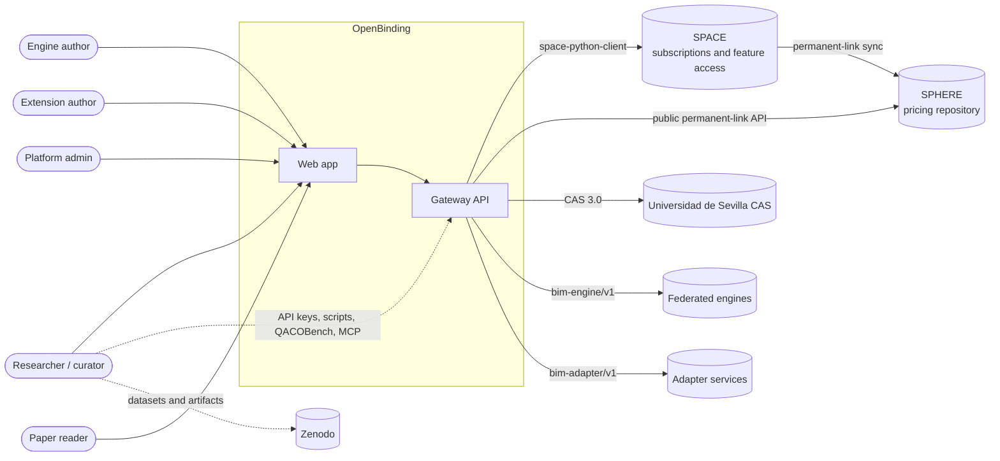
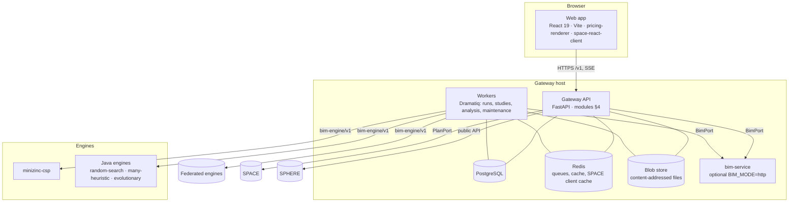
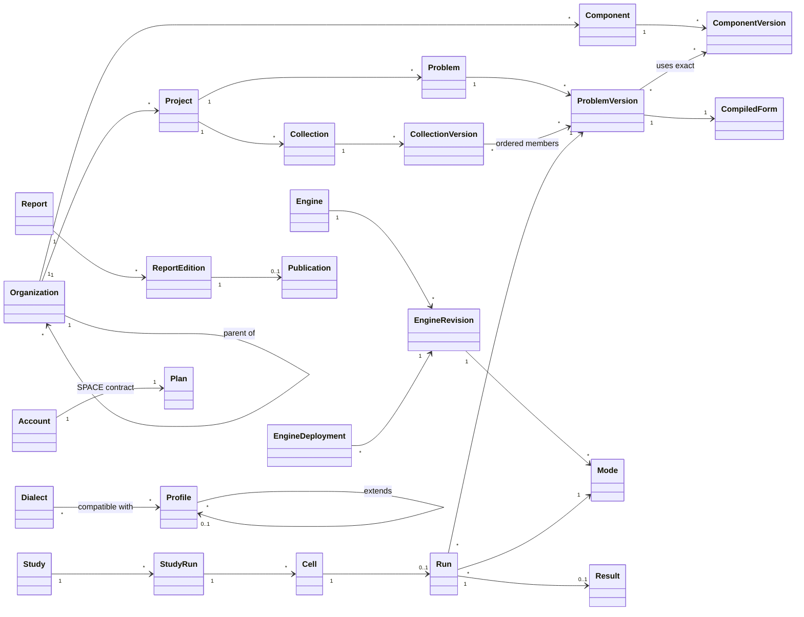
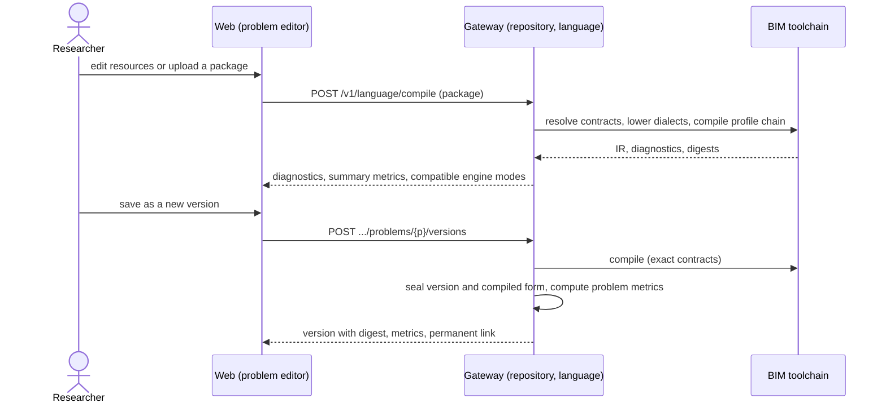
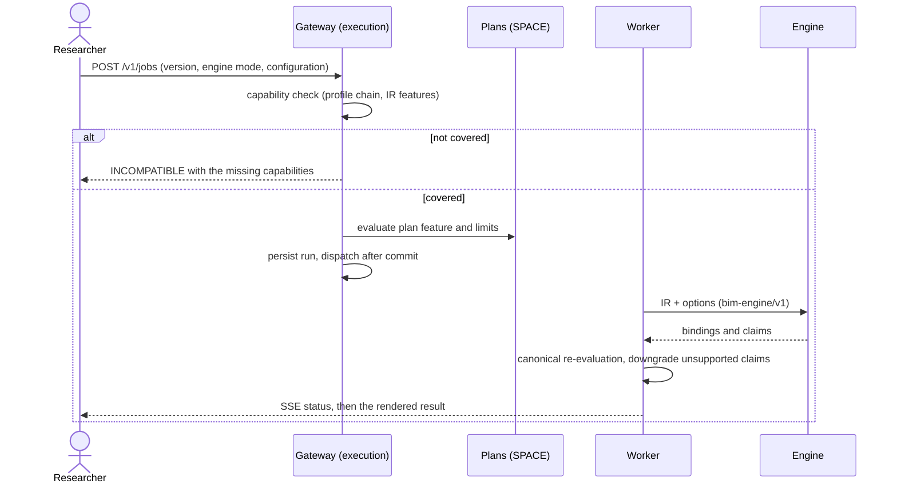
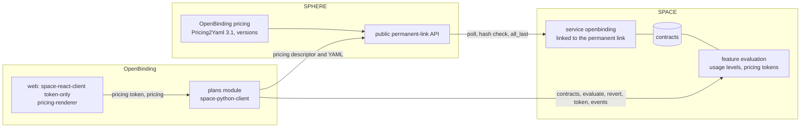

Status: PROPOSED for owner review (2026-10-22).

# OpenBinding architecture (target)

This document describes the architecture OpenBinding is moving to and the rules that get it there. The product
reasons are in [`INTENT.md`](../INTENT.md), the order of work in [`ROADMAP.md`](../ROADMAP.md), the binding rules in
[`constitution.md`](../constitution.md) and the decisions in [`docs/adr/`](adr/). The gateway as it is at 912648c,
with file-level evidence, is in [`docs/architecture/gateway-as-is.md`](architecture/gateway-as-is.md); the BIM
language is in [`BIM_V1.md`](BIM_V1.md) and [`BIM_CORE.md`](BIM_CORE.md).

Contents: 1 Principles · 2 System context · 3 Containers · 4 Backend · 5 Frontend · 6 Domain model · 7 Key flows ·
8 Language extensibility · 9 Plans (SPACE and SPHERE) · 10 Storage and retention · 11 Quality and gates ·
12 Environments and previews · 13 Repository layout · 14 Decisions

## 1. Principles that shape the architecture

1. **One canonical problem, many engines.** BIM packages compile to one canonical IR; engines receive only the IR,
   declare capabilities, and never decide the final numbers: the gateway re-evaluates every binding.
2. **Modular monolith, hexagonal inside.** One deployable gateway split into bounded-context modules; each module
   keeps its domain free of frameworks and reaches the outside world through ports.
3. **Everything external behind a port, everything shared behind a contract.** BIM toolchain, engines, SPACE,
   SPHERE, CAS, blob storage and mail are adapters; contracts are versioned and tested on both sides.
4. **Render, never dump.** The frontend renders every domain object with a shared catalogue of components; source
   views are secondary (constitution, Article 15).
5. **Immutable, digest-addressed evidence.** Versions, compiled forms, runs, study cells and report editions are
   sealed; permanent links and digests make them citable.
6. **Small, reversible steps.** The target is reached by strangling the current code module by module, never by a
   rewrite.

## 2. System context



SPHERE and SPACE are separate deployments of the group: the OpenBinding pricing is written and versioned in SPHERE;
SPACE follows it through SPHERE's permanent link and operates subscriptions. OpenBinding never writes to SPHERE and
never re-implements SPACE (§9).

## 3. Containers



| Container | Responsibility | Technology |
|---|---|---|
| Web app | every screen; renders, never dumps; gates UI features with the pricing token | React 19, Vite, TypeScript, Recharts, `pricing-renderer`, `space-react-client` |
| Gateway API | `/v1` HTTP API, authentication, authorization, all use cases | Python 3.11, FastAPI, SQLAlchemy async, Alembic |
| Workers | runs, study cells, analysis tasks, retention and reconciliation jobs | Dramatiq over Redis |
| PostgreSQL | operational source of truth | PostgreSQL 16 |
| Redis | queues, leases, caches (including the SPACE client cache) | Redis 7 |
| Blob store | content-addressed bytes (packages, uploads, logs, exports) | filesystem volume; S3-compatible later |
| bim-service | the BIM toolchain over HTTP when the gateway runs `BIM_MODE=http` | `isa-group/bim-toolchain` |
| Engines | solvers behind `bim-engine/v1`; built-in ones run beside the gateway, federated ones anywhere | Node/TypeScript (MiniZinc), Java |

## 4. Backend: a modular monolith

### 4.1 Modules (bounded contexts)

| Module | Owns | Main ports used | Code today (to move) |
|---|---|---|---|
| `identity` | accounts, sessions, passwords, API keys, external identities (CAS) | `IdentityProvider` (CAS), `Mailer` | `routes/auth.py`, `routes/users.py`, `routes/cas.py`, `cas.py`, `security/*` |
| `collaboration` | organizations (nested), projects, memberships, roles, invitations, audit, notifications, public read | — | `collaboration.py`, `routes/organizations.py` (org/project/member parts), `repositories/organizations.py`, `access/public_read.py` |
| `repository` | problems and versions, components and their versions, collections, blobs, project packages, permanent links, problem metrics | `BimPort`, `BlobStore` | `artifacts.py`, `routes/artifacts.py`, case/collection/resource/blob routes, `services/snapshots.py`, `services/instances.py` |
| `language` | profiles, dialects, adapters, schemas, examples, compilation, the extension lifecycle | `BimPort`, `AdapterServicePort` | `integrations/bim*.py`, `services/discovery.py`, dialect/resource/profile routes, `v1/archive.py` |
| `engines` | engine revisions, modes and manifests, federated deployments, conformance, capability matching | `EngineTransport` | `services/engines.py`, `services/engine_registry.py`, `services/probe.py`, `v1/remote.py` |
| `execution` | runs: submission, idempotency, dispatch, leases, cancellation, events, re-evaluation, results, neighbourhood | `EngineTransport`, `BimPort`, `PlanPort` | `services/job_submission.py`, `services/execution.py`, `jobs/*`, `job_dispatch.py`, `worker.py`, job routes |
| `laboratory` | studies, study runs, cells, analytics (protocol metrics, trade-offs), the generator | `execution` application API | `studies.py`, `study_jobs.py`, `routes/studies.py`, `analysis_jobs.py`, analysis routes, `generator/*` |
| `publishing` | reports, editions, publications, citations, resolver, verifier | — | `reports.py`, report/publication routes, `routes/resolve.py`, verifier routes |
| `plans` | the SPACE port, the entitlement map, the pricing descriptor, plan changes | `PlanPort` (SPACE), `PricingSource` (SPHERE public API) | `space_client/*`, `services/entitlements.py`, `access/policy.py`, `access/contracts.py`, `domain/entitlements.py`, `sponsor_proposals.py` |
| `administration` | overview dashboards, accounts admin, moderation, queues, errors, maintenance and retention | application APIs of the other modules | `routes/admin.py`, `telemetry.py` |
| `shared` (kernel) | settings, logging, problem+json errors, pagination, digests, clock, ids, mail | — | `core/*`, `mailer.py`, `security/bodylimit.py` |

### 4.2 Layout and dependency rules

```
openbinding-gateway/src/openbinding_gateway/
  app/                 composition root: create_app, lifespan, router registration, middleware, worker entry
  shared/              kernel (no imports from modules)
  modules/
    <module>/
      domain/          entities, value objects, policies; pure Python, no I/O
      application/     use cases, commands and queries, ports (typing.Protocol), public API (__init__.py)
      adapters/
        http/          FastAPI routers, Pydantic request/response schemas, problem mapping
        persistence/   SQLAlchemy models of the tables the module owns, repositories
        <external>/    space/, sphere/, bim/, engines/, cas/, blobstore/, adapters/
```

- Inside a module: `adapters → application → domain`. `domain` imports nothing from frameworks or adapters.
- Between modules: only through the other module's `application` public API, or through in-process domain events
  (audit, notifications, cache invalidation). No cross-module ORM joins; each table has one owning module.
- External systems only through ports: `BimPort` (exists), `PlanPort`, `PricingSource`, `EngineTransport`,
  `AdapterServicePort`, `BlobStore`, `IdentityProvider`, `Mailer`, `Clock`.
- Patterns: ports and adapters; application services as use-case functions; repositories with a unit of work per
  request (SQLAlchemy session); domain events for side effects; dispatch after commit (exists for runs); strategy
  for engine transports (built-in, federated) and adapter tiers (§8).
- Enforcement: `import-linter` contracts (layers per module, module independence) in G9, plus the existing
  `tests/test_architecture_layers.py` ratchets.

### 4.3 Migration: strangler, one module at a time

1. Create `app/`, `shared/` and `modules/` with import-linter contracts; move nothing.
2. New capabilities land directly in modules: `plans` (M4) and the language registry (M5) are the first.
3. Move existing code one module per `refactor/<id>` change, behind characterization tests, keeping
   `docs/openapi.json` byte-identical. Order: plans → language → engines → execution → laboratory → publishing →
   repository → collaboration → identity → administration.
4. Each move deletes the old path, shrinks `ALLOWED_LEGACY`, `GATE_LIFECYCLE_LEGACY` and `MAX_LINES`, and ends
   with `routes/v1.py` and `main.py` reduced to composition.

## 5. Frontend

### 5.1 Layout (feature-sliced)

```
frontend/src/
  app/        providers (auth, query cache, SpaceProvider), router and route registry, shell (header, navigation)
  pages/      route-level screens; compose widgets and features; no HTTP
  widgets/    composite blocks shared by pages (ProblemHeader, RunResult, StudyAnalytics, PlanSummary)
  features/   user actions (create-problem-version, launch-run, compare-runs, publish-report, install-extension, change-plan)
  entities/   read models with their API hooks and small views (problem, version, run, engine, study, collection,
              report, organization, profile, dialect, plan)
  shared/     ui (design system and rendering catalogue §5.3), api (types generated from docs/openapi.json, http,
              problem+json), lib (formatters, digests), config
```

Imports go downwards only (`pages → widgets → features → entities → shared`); features never import each other;
only `shared/api` performs HTTP. The 1,659-line `api/client.ts` is split into `entities/*/api.ts` over generated
types. Enforced with `eslint-plugin-boundaries` (constitution 6.6).

### 5.2 Information architecture

- **Public:** Home · Explore (Problems · Collections · Studies and publications · Engines) · Engines · Language ·
  Pricing · About · Verify · Log in / Sign up.
- **Signed in:** header with organization/project switcher; Home · Problems · Lab (Runs · Studies · Generate) ·
  Engines · Language · Admin (administrators); "+ New" (problem, collection, study, run); search; notifications;
  account menu (Profile · Plan · API keys · Identities · Notifications).
- **Project:** Overview · Problems · Collections · Runs · Studies · Reports · Settings (General · Components ·
  Files · Package).
- **Problem page (the SPHERE "pricing page" analogue):** header with metrics and version selector; tabs Overview ·
  Analysis · Runs · Versions · Source · Settings.

### 5.3 Rendering catalogue

| Component | Shows | Used in |
|---|---|---|
| `MetricCards` | a row of key numbers with units and trend | dashboards, problem and study headers |
| `ProblemSummary` | tasks, candidates, binding-space size (log10), hard/soft constraints, objectives, profile chain, dialects | problem cards and header, Explore |
| `WorkflowGraph` | the compiled workflow (SEQ, AND, XOR with probabilities, LOOP) | problem Overview, version compare |
| `CandidateMatrix` | tasks × candidates × features, colour scales per feature, intervals as ranges | problem Overview |
| `ConstraintList`, `ObjectiveView` | bounds, hard/soft, penalties; objective terms, weights, directions | problem Overview, run result |
| `MetricSmallMultiples` | evolution of problem metrics across versions | problem Analysis, collection analytics |
| `DistributionChart` | feature-value distributions per task or catalog | problem Analysis |
| `BindingTable` | task → candidate → provider with per-feature contributions | run result |
| `QoSAgainstBounds` | aggregated QoS against constraint bounds | run result |
| `ObjectiveBreakdown` | weighted terms of the objective | run result, study cell |
| `ParetoChart` | 2-D fronts; parallel coordinates for 3+ objectives | run result, study trade-offs |
| `EvaluationDiff` | engine-claimed versus gateway-evaluated values and downgrade reasons | run result |
| `VerdictBadge` | OPTIMAL · FEASIBLE · UNSAT · TIMEOUT · INCOMPATIBLE (with reasons) | everywhere a run appears |
| `CapabilityMatrix`, `ConformanceReport` | engine modes × capabilities; verification checks | engines, extensions |
| `StudyMatrix`, `ProtocolMetrics`, `RankingTable` | cells grid; coverage, yield, gap, reconciliation; ranking | studies |
| `DiagnosticsList` | diagnostics grouped by resource and pointer with code and hint | editor, validation, extensions |
| `LogPanel` | collapsed, searchable, downloadable log | run result, admin errors |
| `PricingTable` | the pricing (`pricing-renderer` React adapter) | Pricing, Plan |
| `FeatureGate` | UI gated by plan (`space-react-client` `<Feature>`) | anywhere a feature depends on the plan |
| `PlanUsage` | features and limits of the user's subscription from the pricing token | Plan, dashboards |
| `SourceView` | read-only code viewer with copy and download | only in Source tabs |

Charts use Recharts (already a dependency). A hygiene test forbids rendering `JSON.stringify` output or `<pre>`
outside `SourceView` and `LogPanel` (constitution, Article 15).

## 6. Domain model



Mapping to `v1` names: Problem = `BindingCase`, ProblemVersion = case revision, CompiledForm = snapshot (`InstanceSnapshot`
and its IR), Component = library `Artifact`, Run = `Job`, Result = job result plus re-evaluation. Every sealed entity
has a content digest; permanent links address problems, collections and publications independently of slugs.

## 7. Key flows

### 7.1 Author, validate, version and analyse a problem



### 7.2 Run a problem



### 7.3 Study

A study selects collections or problem versions, engine modes, parameter sets and seeds. A study run expands the
matrix into cells, each one a run with frozen inputs; cells retry independently. Analytics read only re-evaluated
results and compute the QACOBench protocol metrics: coverage (processable over submitted), conditional binding
yield (binding-returning over processable), gap to the certified optimum, verdict reconciliation (an UNSAT proof
contradicted by a validated binding, or an OPTIMAL beaten, invalidates the run), runtime distributions and rankings.

### 7.4 Plans

See §9.3.

### 7.5 Language extension lifecycle

See §8.4.

## 8. Language extensibility

### 8.1 Layers

| Layer | Owns | Changes how |
|---|---|---|
| BIM core | envelope, `Instance`, role-indexed resources, references, digests, provenance | BIM MAJOR/MINOR release only |
| Profile | a problem family: roles and cardinalities, resource types per role, output IR schema, capability vocabulary, limit vocabulary, evaluation semantics, adapter; **may extend one other profile** | new profile version |
| Dialect | a concrete syntax for resources of one or more profiles (media type, schema or XML root), lowered to the profile's canonical resource types or to declared extension points | new dialect version |
| Adapter | the lowering (and, for profiles, compile hooks and evaluator plug-ins) | tier 0, 1 or 2 (§8.3) |
| Extension package | a digest-addressed bundle: manifests, schemas, adapter descriptor, golden examples, documentation | submitted and reviewed (§8.4) |

### 8.2 Profiles that extend profiles

A profile may declare `extends: {namespace, name, version, digest}` (single inheritance). The child inherits the
parent's roles, cardinalities, resource types, vocabularies and output schema, and may:

- add roles and resource types, and tighten (never loosen) cardinalities;
- add capability dimensions and values, and limit names;
- extend the output IR with new sections described by a schema delta, without changing the meaning of any parent
  field;
- add evaluation semantics (constraints, aggregation operators, objective terms) implemented in the canonical
  evaluator, so the gateway can re-evaluate every binding (constitution 17.3);
- add compile hooks: deterministic pre-solve transforms from extension resources to features or constraints.

Compilation resolves the chain from the root, validates roles and cardinalities against the merged contract, lowers
dialects, runs the parent's lowering, then each child's lowering and hooks, validates the merged output schema and
records the whole chain, every adapter digest and the compiler digest in the IR.

**Placement becomes the reference extension.** `qos-binding-placement/v1` is re-declared as a profile extending
`qos-binding/v1`. It adds the `Placement` resource type in the `candidateCatalog` role (pools, capacities, network
latencies, events, transitions, global latency: the `R` and `L` of the CLASP model), its capability dimension and
evaluator semantics. Its output keeps today's `BindingProblem.spec.placement` shape, so engines, goldens and digests
of existing placement problems do not change; only the declaration moves from the core profile into the extension.
A pricing-aware profile (candidates as subscriptions; iPricings plus expected consumption compiled to cost features,
as in CLASP and PACO) is the next candidate. A domain that fits the core without new semantics — quantum resource
selection — needs no extension at all: it is plain BIM data.

### 8.3 Adapter tiers

| Tier | What it is | Who can install | Safety |
|---|---|---|---|
| 0 Built-in | reviewed Python in `bim-toolchain` (qos-binding, placement, BPMN) | ships with a BIM release | code review, goldens, consumer contracts |
| 1 Declarative | a mapping document evaluated by bim-core's sandboxed transform engine (BIM Expression IR plus structural mapping); no code | organization admins for their organization; platform admins publicly | total and bounded (size, steps, time); double lowering must match byte for byte |
| 2 Adapter service | an HTTP service implementing `bim-adapter/v1` (`GET /manifest`, `GET /health`, `POST /lower`) | platform admins | registered and verified like a federated engine: destination policy, authentication, determinism probes; outputs cached by input digest and stored with the compiled form |

BPMN stays tier 0 but is packaged and installed through the same lifecycle, as the reference for third-party
dialects.

### 8.4 Lifecycle

`draft → submitted → checked → approved → installed → deprecated → retired`, per exact version. Checking runs schema
validation, the golden examples, double lowering, and for tier 2 the conformance probes. A deprecated version still
compiles existing problem versions and is not offered for new ones; a version used by a sealed or cited problem
version is never retired. Approval in production is an owner decision (constitution 17.6).

### 8.5 Language API

| Operation | Purpose |
|---|---|
| `GET /v1/language` | overview: BIM core version, compiler digest, installed profiles and dialects, counts |
| `GET /v1/language/profiles`, `.../profiles/{namespace}/{name}`, `.../versions/{version}` | profiles with their chain, roles, capabilities, schemas and supporting engines |
| `GET /v1/language/dialects` (same shape) | dialects |
| `GET /v1/language/schemas/{kind}` | schemas (download) |
| `POST /v1/language/compile` | compile a package or an exact problem version: diagnostics, summary metrics, compatible engine modes |
| `POST /v1/language/extensions`, `GET .../extensions`, `GET .../extensions/{id}` | submit an extension package and follow its checks |
| `POST /v1/language/extensions/{id}/{approve,reject,deprecate,retire}` | administer the lifecycle |
| `POST /v1/language/adapter-services` and `.../{name}/{activate,deactivate}` | register tier 2 deployments |

The current `/v1/profiles`, `/v1/dialects`, `/v1/resources`, `/v1/schemas/{kind}`, `/v1/catalog`, `/v1/examples`
and `/v1/validate` stay as aliases with `Deprecation` and `Sunset` headers for one minor release (CRP).

### 8.6 Developer kit

`bim-toolchain` ships a `bim-ext` command: `new` (scaffold a dialect or profile), `test` (schemas, golden examples,
double lowering), `pack` (extension package and digest) and `submit` (to a platform with an API key), plus a template
repository and a how-to in `docs/`.

## 9. Plans: SPACE and SPHERE

### 9.1 Topology



| Who | Responsibility |
|---|---|
| SPHERE | authoring and versioning of the OpenBinding pricing; public permanent-link API |
| SPACE | contracts, feature evaluation, usage levels, contract migration when the pricing changes, events |
| OpenBinding | enforcement points, contract creation (registration, CAS link), plan changes for free plans and by administrators, pricing display, token issuance to the browser |

### 9.2 Gateway side

- `modules/plans` implements `PlanPort` with `space-python-client` 1.x (asynchronous transport, Redis cache provider)
  and a MANAGEMENT-scoped key; `OpenGate` remains for development and tests and is refused with `APP_ENV=prod`.
- The **entitlement map** (operation → SPACE feature id `openbinding-<name>` and limits) lives in
  `modules/plans/domain`. At start-up and on `pricing_activated`, the gateway checks that every feature and limit it
  references exists in the active pricing and fails closed otherwise.
- Gated operations call `evaluate(user, feature, expected_consumption)`; an operation that fails after consuming
  calls `revert_evaluation` (SPACE honours it within two minutes).
- SPACE events (`synchronized`, `pricing_created`, `pricing_activated`, `pricing_archived`, `service_disabled`)
  invalidate caches and are relayed to browsers as a `plans.changed` notification.
- `GET /v1/plans/pricing` (public) returns the pricing descriptor (permanent link, SPHERE version id and label,
  content hash, the version SPACE has activated) and the YAML read from SPHERE's public API (bounded to 5 MiB,
  hash-verified, ETag-cached). OpenBinding holds no SPHERE key.
- Removed: `sphere_client.py`, `pricing_catalog.py`, the deprecated `/v1/pricing` proxy and `/v1/pricing/catalog`,
  admin pricing validation, `space_client/deployments.py` and the release sweeps (ADR-0015).

### 9.3 Browser side

- `SpaceProvider` with `allowConnectionWithSpace: false`; the token comes from `GET /v1/users/me/pricing-token` and is
  refreshed on sign-in, on plan change and on `plans.changed`. No SPACE key ever reaches the browser.
- `<Feature id="openbinding-…">` gates UI; the server enforces the same decision.
- The Pricing page and the account Plan page render the pricing with `pricing-renderer` (React adapter, themed with
  the OpenBinding tokens); signed-in users see their plan selected; free plans change self-service, other plans
  show "Contact us".
- `space-react-client` 0.3.3 declares React ^18.3.1; OpenBinding runs React 19. A spike validates it in token-only
  mode; if it fails, the fix is proposed upstream to `Alex-GF/space-react-client` rather than forked.

### 9.4 Lab: two connected deployments

The lab gains an optional `pricing` profile modelled on the TomatoMeter lab: pinned public images of SPHERE
(`ghcr.io/scorelabus/sphere-api`, `sphere-client`, MongoDB, Redis) and SPACE (`space-api`, `space-client`, MongoDB,
Redis) on the lab network, plus a one-shot `pricing-bootstrap` that creates the lab users and organization,
publishes the reference pricing `deploy/pricing/openbinding.yml` in SPHERE, links the SPACE service to its permanent
link (`all_last`, one-minute poll), stores the SPACE key in the lab secret store and creates contracts for the
synthetic users. Estimated memory ≈ 1.5 GiB, measured before it is enabled by default. Production uses the group's
deployments by configuration only.

## 10. Storage and retention

| Data | Where | Retention |
|---|---|---|
| Sealed problem, component and collection versions, compiled forms, published report editions | PostgreSQL + blob store | permanent; withdrawal hides, never deletes |
| Drafts | PostgreSQL | until deleted; owner notified after 180 idle days |
| Runs and results | PostgreSQL + blob store | permanent while referenced by a study, report or publication; otherwise per plan history limit |
| Raw engine logs | blob store | 90 days unless pinned by a study cell, report or publication |
| Uploads not referenced by any version | blob store | 30 days |
| Notifications | PostgreSQL | 180 days |
| Audit events | PostgreSQL | permanent |
| Lab previews | lab Docker volumes | expire after 7 idle days; `develop` preview is permanent |
| Factory work trees and task branches | lab project directory | archived within 24 h of merge or cancellation; archives kept 30 days |
| Factory and gate reports | lab state | 90 days, except release evidence |
| Datasets, raw campaign results | Zenodo | never in Git or the platform database |

Purges run through `/v1/admin/maintenance/preview|purge` and scheduled workers; factory retention runs through the
factory's maintenance operations (constitution, Article 18).

## 11. Quality architecture

| Level | What | Where | Gate |
|---|---|---|---|
| Specification | EARS requirements with `req~…~N` ids, scenarios | `openspec/` | G1, G2 |
| Acceptance | executable scenarios written from the spec before the code: API flows with pytest, UI flows with Playwright | `acceptance/api/`, `acceptance/ui/` | G3, G4 |
| Unit and property | pytest, Hypothesis, Vitest | per package | G5 |
| Contract | OpenAPI snapshot, JSON Schemas, Schemathesis, BIM and engine consumer contracts, SPACE/SPHERE against pinned images | CI and lab | G7 |
| Traceability | OpenFastTrace over specs, code, tests and acceptance | CI | G6 |
| Mutation | mutmut (Python), Stryker (TypeScript) on changed code | Actions | G8 |
| Static | ruff, mypy (ratcheted), ESLint, Semgrep, dependency audit, licences, import-linter, boundaries | CI | G9 |
| Secrets and ownership | secret scan, owned globs | CI | G10 |
| Review panel | reviewers by risk | factory | G11 |
| Preview | lab deployment, Playwright flows, ui-qa screenshots (desktop and mobile), axe | NiPoGi lab | G12 |

Acceptance tests are the specification made executable: each scenario carries `[utest->req~…]`, is frozen before
implementation and runs against the preview of the change's head.

## 12. Environments and previews

| Environment | Where | Data | Purpose |
|---|---|---|---|
| Development | developer machine or factory work tree, `docker compose` | synthetic | build and unit tests |
| Lab | NiPoGi rootless lab Docker (`compose.lab.json` profiles) | synthetic seed | integration, gates, e2e |
| PR preview | NiPoGi lab, one stack per PR head on demand | synthetic seed | G12 before merging into `develop` |
| Develop preview | NiPoGi lab, follows `develop`; `https://openbinding.home.javiercavlop.com` | synthetic seed | the owner reviews `develop` from the Mac or the iPhone |
| Production | Universidad de Sevilla servers (`openbinding.score.us.es`) | real | only on the owner's order |

The develop preview sits behind the homelab Caddy (TLS, home network and tailnet) with an AdGuard rewrite; its
origin is added to `CORS_ALLOW_ORIGINS` of the preview stack. PR previews expire after 7 idle days.

## 13. Repository layout

The application directories keep their names; the clutter at the root moves:

| From | To |
|---|---|
| `compose.lab*.json`, `compose.pgtest.json` | `deploy/compose/` |
| `nginx/`, `up.sh` | `deploy/` |
| `pricings/` (FaaS iPricings of CLASP) | `experimentation/clasp/pricings/` |
| `output/` (Zenodo packaging) | `experimentation/qacobench/zenodo/` |
| — | `acceptance/` (new), `deploy/pricing/` (new) |
| `bim-toolchain/` | removed after the extraction to `isa-group/bim-toolchain` (ADR-0004) |

Each move is one `refactor/<id>` change that updates CI, Dockerfiles, documentation links and tests together.

## 14. Decisions

| ADR | Decision |
|---|---|
| [0001](adr/0001-record-architecture-decisions.md)–[0013](adr/0013-committed-openapi-snapshot.md) | baseline decisions (BIM as canonical language behind a port, engines as services, durable jobs, pinned MiniZinc, datasets outside Git, frontend stack, problem+json, layered gateway, OpenAPI snapshot) |
| [0014](adr/0014-render-never-dump.md) | render, never dump |
| [0015](adr/0015-plans-through-space-and-sphere-clients.md) | plans through SPACE and SPHERE with their real clients (supersedes 0010) |
| [0016](adr/0016-extensible-language-profiles-and-dialects.md) | profiles that extend profiles, adapter tiers, language API |
| [0017](adr/0017-modular-monolith-and-feature-sliced-frontend.md) | modular monolith and feature-sliced frontend (evolves 0012) |
| [0018](adr/0018-problem-centred-vocabulary.md) | problem-centred vocabulary in the UI, API `v1` unchanged |
| [0019](adr/0019-previews-and-retention.md) | previews before merge and storage retention |
